# Would you give this investment committee money?

We gave an AI investment committee a simulated $100,000, several analysts, opposing researchers, a trader, a risk discussion, and a portfolio manager. Across the eight decision dates with completed five-session outcomes, the default committee averaged **$11.67 in trading profit after fees**. Buying SPY averaged **$458.44**. The committee did produce considerably more meeting notes.

Those dollars measure our fixed rule for turning a rating into a position. When we opened the worst recommendation, we found something the headline misses: the committee had attached a condition to buying, and our simulator did not execute that condition. The investigation below holds us responsible for that translation as well as the agents for their advice. We then fixed the execution contract and ran 360 new decisions: the default committee made $130.56 on average while putting much less money to work. The cheaper committee mostly chose cash. Its explanation exposed another problem in our setup.

I wanted to be able to open one of those recommendations and check what happened: which analyst supplied the evidence, what a tool actually returned, whether the discussion changed the decision, and how the final position performed. We built that route in a [TradingAgents fork](https://github.com/ash0ts/TradingAgents). Agent Lens holds the readable conversations and execution history. Forge holds the comparisons, saved notebooks, dashboards, and versioned evidence.

This article follows a TradingAgents recommendation from its financial result into the analyst reports and tool calls behind it, then tests it against simpler methods and the practical decisions an investor would face. The practical questions are less glamorous than predicting an election: did the stock selection help, did cash protect the account, would a later entry erase the result, and should missing news have stopped the trade?

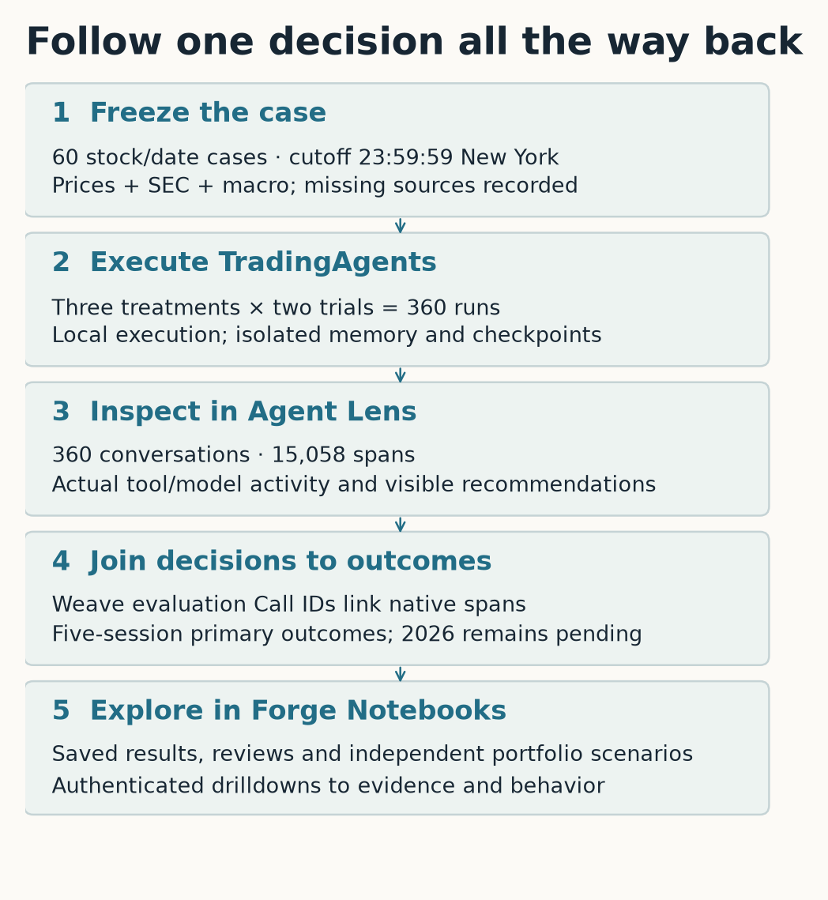

*The implemented trading workflow. Each stage preserves the identity of the case and execution. [Full-size image](assets/evidence-chain.png).*

## Start with a result you can investigate

The [financial dashboard](https://forge.coreweave.com/wandb/wandb/tradingagents-election-lab?nw=0q277wzs5up) and [comparison notebook](https://forge.coreweave.com/notebooks/Tm90ZWJvb2s6MTUyNzI%3D) contain all 13 methods. Each decision date starts a fresh scenario; the opening numbers are descriptive averages, not compounded returns or a forecast for next week. Model expense is separate.

*Eight matured decision dates. Agents have two trials per date; other methods have one. Fees are 10 basis points per side. Exposure differs: the default committee averaged about 45% invested, versus almost 100% for SPY. This is a comparison under the stated allocation rules, without equalizing risk. [Exact figure data](assets/portfolio-pnl.csv). [Full-size image](assets/portfolio-pnl.png).*

A low bar is easy to clear if we call every passive alternative “doing nothing.” Cash earns zero interest in this simulator. Buying SPY and waiting is another choice; buying the six-stock basket is a third. The default committee barely beat idle cash and trailed both invested controls. A dashboard that showed only the cash comparison would make an excellent sales slide and a rather incomplete experiment.

To investigate a result, open its saved notebook row, follow the Agent Lens conversation, select an analyst in the span tree, and inspect the model and tool activity beneath it. The notebook also selects the strongest result, weakest result, and a fixed-seed random example. That keeps the tour from consisting entirely of whichever anecdote makes our point most neatly. Public readers get sanitized tables and captures; the live Agent Lens drilldowns require team access.

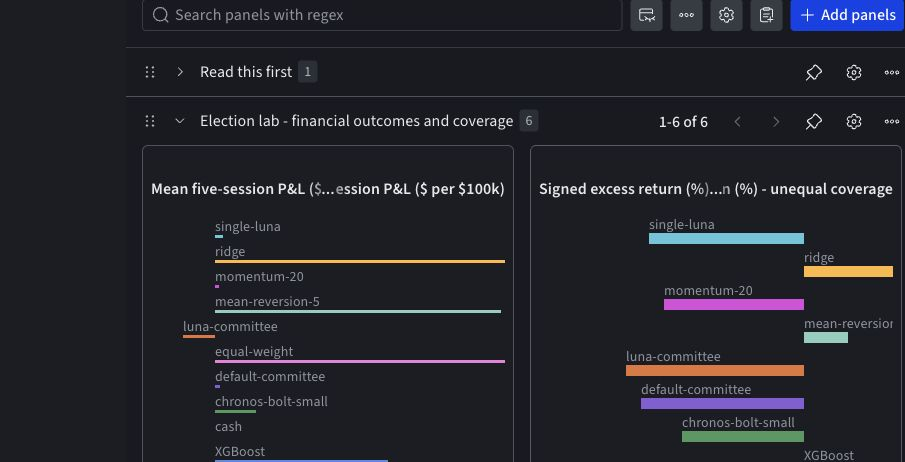

*Two panels from the saved financial workspace, captured November 6. Portfolio P&L and signed excess return answer different questions. The native panels below this section let you inspect the saved method summaries; downloadable tables retain every case. [Full-size image](assets/forge-financial-dashboard.png).*

<!-- native-panel:financial -->

The election supplied the premise, with an awkward but useful deadline. This release freezes market data through **November 5, 2026**. Its current-midterm five-session outcomes remain pending, including in this November 9 article revision. The opening results come from older cohorts. Keeping that freeze lets readers reproduce the original comparison.

## Open the worst trade before blaming the committee

We started with UNH on November 7, 2022, trial 1 of the default committee: the original weakest example by signed excess return. Its Overweight was on the wrong side of a **13.36-percentage-point** move relative to SPY. Under our fixed allocation rule, the UNH sleeve lost **$1,153.72** after fees. That is one sleeve within the $100,000 account, not a loss on the whole account.

The [internals dashboard](https://forge.coreweave.com/wandb/wandb/tradingagents-election-lab?nw=dufjini1rvb) links this result to the original Agent Lens conversation. Follow the Research Manager, Trader and Portfolio Manager in its span tree. The handoff looks like this:

| Stage | What the saved output says or does |
|---|---|
| Research Manager | Overweight; build a modest position gradually and seek more evidence before increasing it |
| Trader | Buy, but “favor adding only on confirmation above that zone” |
| Portfolio Manager | Overweight; “favor a modest, conditional increase rather than an immediate full-size buy” |
| Our simulator | Invest 75% of a fresh sleeve at the next session's close, then hold five sessions |

The final report preserves the breakout requirement. The simulator consumes the rating and drops that requirement. It also ignores the proposed stop and staged entry. We can reproduce the $1,153.72 loss exactly while still having failed to simulate the strategy described in the prose. Accounting tests do not catch that mismatch; reading the recommendation does.

This does **not** tell us the conditional strategy would have made money or avoided the trade. “Confirmed breakout” needs an executable definition, an expiry and a policy for missing inputs before we can test it. We have kept the original result unchanged and recorded the mismatch as a development regression case.

There is another mismatch in the recorded input. The portfolio manager is told that holdings and cash were not provided and to “not assume a flat book.” Our simulator starts every account entirely in cash. The agent's “trim an existing position” and our “open a smaller new position” can share an Underweight label while describing different trades. In the original seeded-random AAPL example, the trader's Sell explicitly means a partial trim “rather than exiting outright.” Calling that a contradiction based on two labels would throw away the instruction that explains it.

We then checked every saved output, not just the bad example. A deliberately simple phrase search finds conditional wording in **81/120 default-committee** and **45/120 all-Luna** reports. These are candidates: “only if” can constrain a sale or a portfolio limit rather than an entry. Separately, the final horizon field literally says “not provided” in **58/120** and **16/120** reports respectively. We have not converted those counts into failure rates.

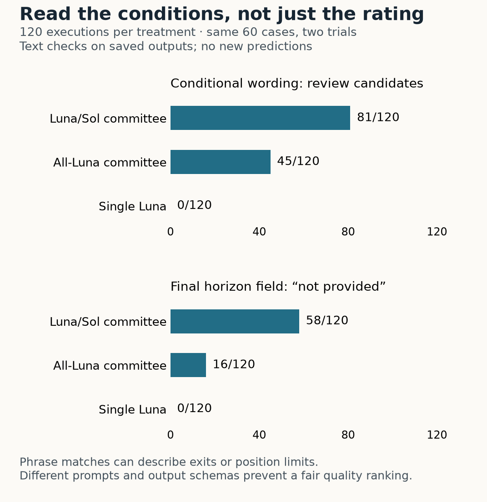

*Checks on original saved outputs, with [all 360 rows and exact definitions](../internals/README.md). The single analyst has a different mandate and output format; its zeros do not establish higher quality. [Full-size image](assets/internals-contract-checks.png).*

<!-- native-panel:internals -->

## Did the risk discussion change its mind?

We compared the Research Manager's recommendation with the final Portfolio Manager rating within each committee execution. They matched in **238 of 240 runs**: 118/120 for the default committee and 120/120 for all-Luna. This starts *after* the bull/bear debate. It says nothing about whether that earlier debate helped, and it misses changes to sizing, conditions and explanations. UNH shows why unchanged labels can conceal substantive discussion.

Both changed ratings are worth opening. For NVDA immediately after the 2024 election, the second default trial moves from Overweight to Hold. The final report says the evidence cannot establish “today's risk-reward.” For UNH after the 2023 control date, the first trial moves from Underweight to Hold because the historical readings “cannot establish current downside risk.” Both are responses inside a historical replay. They contain a visible shift toward advising someone trading today.

That gives us a specific instruction problem to investigate: the decision date, holding period, benchmark and portfolio state must survive every handoff. The two examples do not establish how much return this drift cost, or that adding another date reminder will fix it. We also cannot call the remaining discussions wasted simply because the rating survived them. The [five selected reviews](../internals/reviews.json) retain the short source excerpts, evidence hashes, selection rules and proposed checks; they are **Codex assistant reviews**, not domain-expert labels.

We inspected a success too. The strongest default-committee directional example is UNH after the 2025 control date. Its Underweight correctly anticipates underperformance, scoring **+5.39 percentage points** of signed excess return. Its quarter-invested sleeve nevertheless loses **$203.27**. A correct relative call can still lose cash when the stock falls. The report also names “the next earnings and guidance update” as its horizon, while we grade five sessions. A favorable score does not make that mismatch disappear.

Cash explains part of the weak headline, but it does not explain all of it. Substituting SPY at the committee's own invested fraction produces $156.15 rather than $11.67. That descriptive comparison points us toward the allocation as well as the amount invested; it is not risk matching or proof of a faulty forecasting mechanism. Missing news is a separate observed limitation. Because that source is missing throughout the study, these data cannot isolate its effect on returns.

## Test the decisions people actually face

A question in [r/algotrading about earnings](https://www.reddit.com/r/algotrading/comments/1t6u14f/how_do_you_work_with_earnings/) is recognizably practical: stay in, reduce size, or skip the event? Another [discussion of backtest sizing](https://www.reddit.com/r/algotrading/comments/1qr4abm/position_sizing_for_backtesting/) raises the danger of accumulating too much exposure across simultaneous positions. These are examples of practitioner concerns, not evidence that a particular trading rule works.

For this study, the relevant extension is to make the same TradingAgents decisions face more demanding trading conditions. We ran seven allocation and execution profiles across **all 60 original cases and all 13 methods**. The result is 1,120 independent account replays: 896 matured and 224 pending. This is a **post-hoc robustness analysis** added on November 9, not 1,120 new forecasts, market events, or untouched tests.

| Investor's question | What this release actually tests |
|---|---|
| Did it pick useful stocks, or just hold cash? | SPY and the equal stock basket at each method's invested fraction, date by date and trial by trial |
| What if I act a day later? | Entry at the second session's close, followed by the same five-session holding period |
| Does a thin result survive friction? | 25 basis points per side, compared with the original 10 |
| Can I limit how much capital is exposed? | Proportional reduction of targets when the account would deploy more than 50% |
| Should an event trade proceed without archived news? | An external rule that leaves agent sleeves in cash when the frozen news source is missing |
| Is the result specific to one window or stock? | Separate election/control cohorts and contributions from every stock, with no case removed |

The original analysis also appears as the seventh profile, so the replay can reconcile against its saved accounts. The [scenario protocol and evidence](../trading-scenarios/trading-scenarios-evidence.zip) include dates, weights, costs, daily equity, stock contributions, and public unit-account factors for offline reproduction. These profiles reuse the saved recommendations; they do not claim the agents understood a portfolio constraint that was never in their prompts.

The calendar deserves a closer look too. The [November 10, 2022 CPI release](https://www.bls.gov/news.release/archives/cpi_11102022.htm) and the [November 7, 2024 Fed statement](https://www.federalreserve.gov/newsevents/pressreleases/monetary20241107a.htm) fall inside some of the election holding windows. The Fed statement announced a quarter-point cut. Calling the whole resulting price move an “election effect” would be a stretch. These sources supply context for this article; their contents were not retroactively inserted into the agents' evidence bundles.

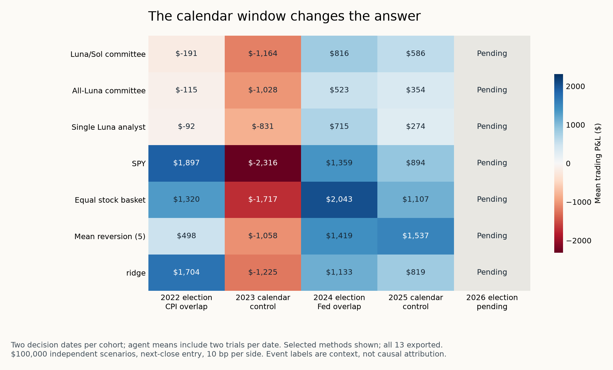

*Two decision dates per cohort, with agent trials averaged. The chart shows seven methods; [all 13 are exported](../trading-scenarios/cohort-breakdown.csv). Event annotations describe overlapping windows, not causes. [Full-size image](assets/trading-cohort-results.png).*

In the 2023 control window, the default committee lost about $1,164 while fully invested SPY lost about $2,316. In the 2024 election window, the committee made about $816 while SPY made about $1,359. That is a more useful picture than one grand average: staying partly in cash can soften a losing window and limit participation in a rising one. It does not, by itself, establish successful market timing.

AAPL, MSFT, and NVDA give us three technology names; JPM, XOM, and UNH expose the comparison to banking, energy, and healthcare. The [stock contribution table](../trading-scenarios/stock-contributions.csv) preserves every case, rating, trial, and evidence digest. One bank or insurer is not a sector index. We can inspect whether a single name dominates a result without pretending this is a diversified sector study.

We have **not** run an earnings-surprise benchmark or a crash benchmark. Those need event membership and timestamped announcements fixed before inference. Nor does this account begin with the reader's existing holdings or tax lots. Those are important next scenarios, and attaching their names to the present data would not make them tested.

## What the committee was allowed to know

The [TradingAgents paper](https://arxiv.org/abs/2412.20138v7) describes specialists preparing reports, bull and bear researchers debating positions, and trading and risk roles working toward a recommendation. Our fork retains that inspectable structure. It changes the models, dates, evidence delivery, and evaluation procedure, so this study is a separate measurement rather than a reproduction of the paper's backtest.

There are three LLM treatments: the repository-default Luna/Sol committee, an all-Luna committee, and a single Luna analyst receiving a compact evidence bundle. Each runs twice on every case. AAPL, MSFT, NVDA, JPM, XOM, and UNH appear on the trading sessions immediately before and after each anchor, with SPY as the benchmark:

| Cohort | Anchor | Five-session outcomes at the freeze |
|---|---|---|
| Previous midterms | November 8, 2022 | Matured |
| Calendar control | September 12, 2023 | Matured |
| Previous presidential election | November 5, 2024 | Matured |
| Calendar control | September 9, 2025 | Matured |
| Current midterms | November 3, 2026 | Pending |

That makes 60 stock/date cases and 360 agent executions. Another 600 prediction records come from numerical and passive methods. Two trials on the same stock and date measure some model variability; they do not create a second market event. The selected controls give us ordinary dates to inspect, but this small sample cannot establish an election effect.

Information ends at 23:59:59 America/New_York on the decision date. Entry is at the following trading session's close, and the primary outcome ends five sessions after entry. One- and twenty-session outcomes are secondary. A model therefore cannot see the decision day's closing price and receive an execution at that same close.

Frozen inputs include prices, corporate actions, available SEC company facts, and ALFRED macroeconomic vintages. Availability time is separate from collection time: a fact collected in 2026 might have been available in 2022, while another fact *about* 2022 might only have appeared later. Vendor corrections to historical prices remain a limitation.

The largest gap is inconvenient for an election demo: we did not have usable archived news or social feeds. This is a prices/SEC/macro study. Replay allows model and tracing traffic, but missing evidence cannot trigger a live search, including through direct sentiment or identity lookups. Cases and treatments have separate memory and checkpoints; outcomes stay outside the supplied evidence.

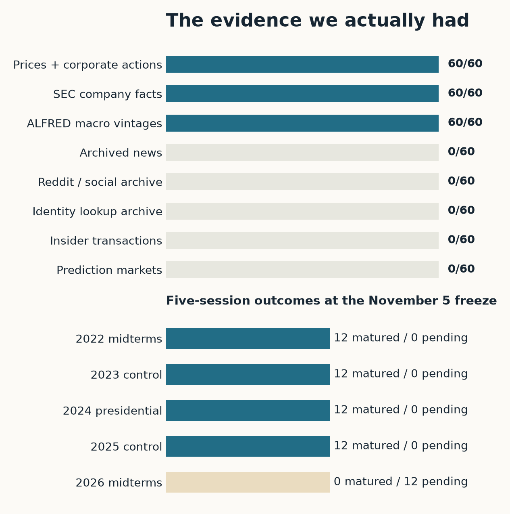

*Availability and outcome maturity are separate checks. The [coverage export](../evidence/source-coverage.csv) lists every missing source. A source being available does not establish that its contents are complete or correct. [Full-size image](assets/coverage-and-maturity.png).*

These controls make supplied evidence auditable. They cannot remove historical knowledge from pretrained weights. A model answering a 2022 question in 2026 may already know the outcome, which is why we call this **retrospective replay**. [Agent Market Arena](https://arxiv.org/abs/2510.11695v2) explores continuous evaluation in live markets, a complementary way to reduce that particular problem. Frozen cases are useful for debugging; a later forward window would support a stronger claim about future decisions.

## Follow the missing news

In the UNH case immediately before the 2026 midterms, the news tool returned `DATA_UNAVAILABLE`. The committee finished successfully. Its financial outcome was still pending, but we could already inspect the gap between a completed workflow and complete evidence.

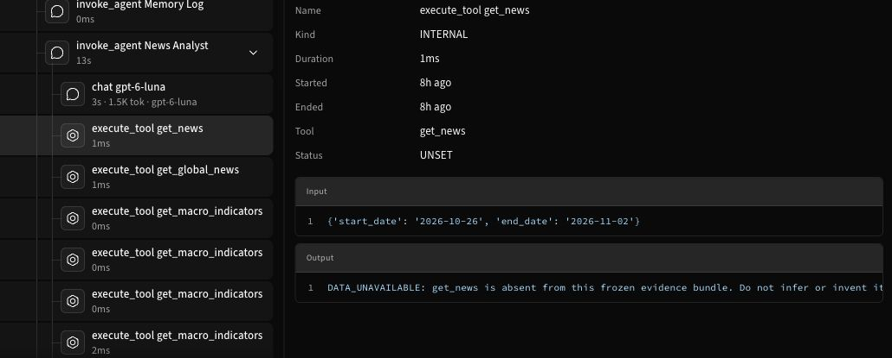

*Actual Agent Lens tool details, captured November 6. The requested dates and missing-data response are visible. Private trace identifiers and unrelated source bodies are outside the capture. [Full-size image](assets/lens-missing-news.png).*

The useful finding is specific: this tool had no archived news to return, and replay preserved that absence. The reviewed case records an evidence-coverage failure. It does not establish that the model invented an article. Obtaining an archive and changing the prompt's handling of missing evidence are different interventions; this trace tells us which condition existed during the run.

The span tree keeps the analyst reports and later committee decisions together. A trader and portfolio manager can disagree because discussion changes the recommendation. To decide whether that is a contradiction, a reviewer needs the order of events, the evidence available at each stage, and the scope of each recommendation. The reports are actual visible outputs. They do not reveal an unrecorded internal thought process or prove that a particular sentence caused the final choice.

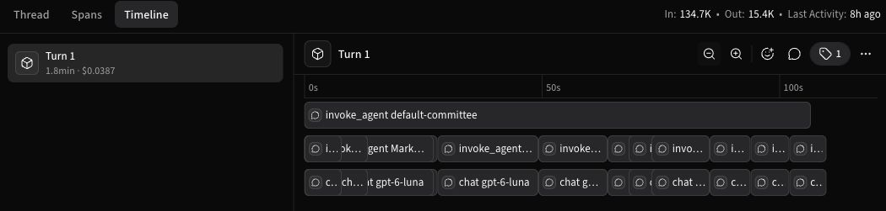

*The same UNH case, trial 0, zoomed out to the full turn. Parallel analyst activity overlaps in the native timeline; drill into a span for the details. Historical market dates are metadata. Execution timestamps show when the software actually ran. [Full-size image](assets/lens-timeline.png).*

We had to be equally careful with our own failure detectors. Across 360 runs, deterministic checks flagged 240 instances of missing tool evidence, five missing-acknowledgment candidates, two unavailable-evidence-as-fact candidates, one repeated tool call, and one unsupported-price candidate. These overlap. The 240 missing-evidence flags cover the committees, whose tools encounter unavailable sources; the single analyst receives its bundle directly. Raw counts partly measure this workflow difference.

Six selected findings received a **Codex assistant review**, explicitly labeled as such. Five were false positives. One confirmed the missing-news gap. In one UNH report, the checker missed the acknowledgment because the agent used “lacks.” In an AAPL report, a conditional discussion of an unconfirmed breakout looked suspicious when stripped of its condition. Our evaluation code needed to get better at recognizing the acknowledgment it had asked for.

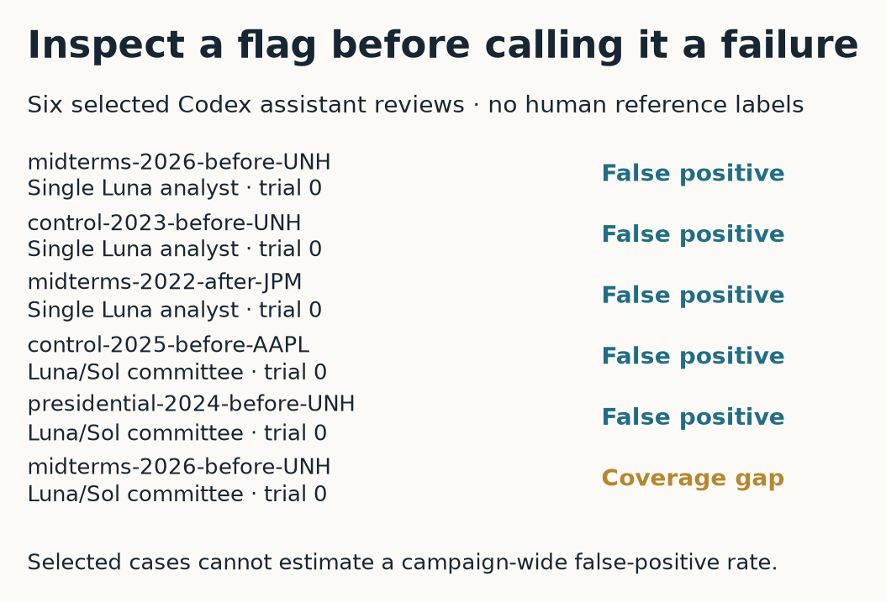

*Selected assistant reviews, not a human-labeled benchmark or an estimate of the population false-positive rate. The [review export](../evidence/assistant-reviews.csv) preserves the rationales and evidence digests. [Full-size image](assets/reviewed-candidates.png).*

The [investigation notebook](https://forge.coreweave.com/notebooks/Tm90ZWJvb2s6MTUyNzE%3D) keeps candidate tags separate from reviewed findings and exports the confirmed case into a versioned regression dataset. We did not enable an uncalibrated LLM judge. Anthropic's [agent-evaluation guide](https://www.anthropic.com/research/demystifying-evals-for-ai-agents) provides useful context for combining code, model, and human graders. Here, the next review should include a domain expert and unflagged cases too. Once a discovered case informs a fix, it becomes development evidence; we cannot sell it back to ourselves as an untouched test.

## Use Insights when it has evidence; keep investigating when it does not

We checked the project's native Insights page on November 9. It had **no completed clustering run**, and its API returned no classified weeks. The UI says Insights runs daily after a project accumulates **1,000 new turns**. The original campaign has 360; even the 360-execution rerun below leaves this study below that threshold. We did not manufacture more conversations to obtain a populated chart.

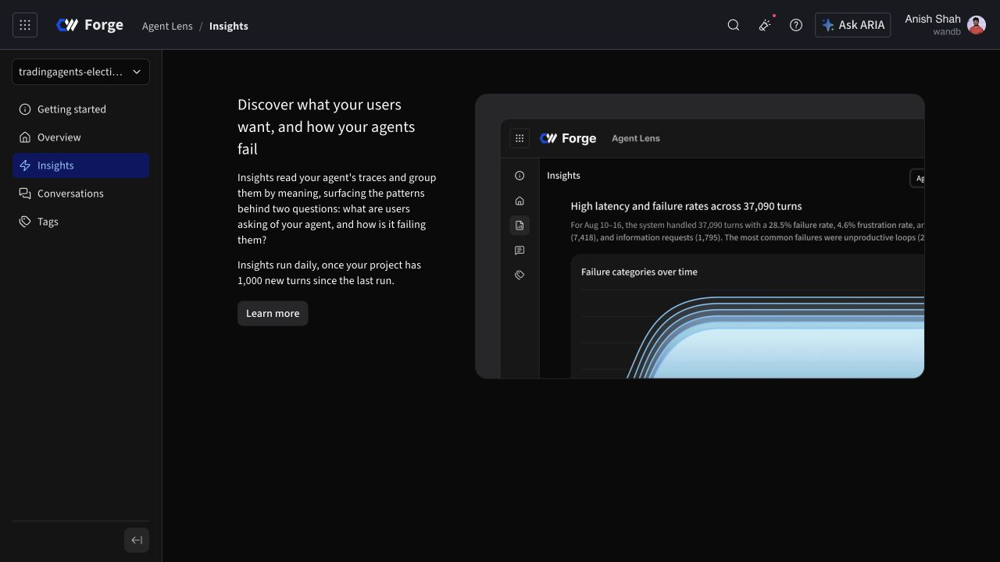

*Actual project state on November 9. The chart on the right is the product's onboarding illustration, not results from this study. [Recorded availability check](../internals/insights-status.json). [Full-size image](assets/lens-insights-eligibility.png).*

The [documented Insights workflow](https://docs.coreweave.com/products/agent-lens/insights) groups turns by intent or failure and provides example conversations to inspect. Once eligible, we would examine categories such as task misunderstanding and missed requirements, then compare their examples with the actual request. A category or generated cluster name would still need that review. Financial loss alone cannot establish a behavioral failure, and the agent trace cannot reveal a simulator's discarded condition unless we also inspect the execution rule.

For this release, we added three native saved views: **conditional wording candidates**, **explicit missing horizon**, and **assistant-reviewed handoffs**. Open them from the [internals dashboard](https://forge.coreweave.com/wandb/wandb/tradingagents-election-lab?nw=dufjini1rvb). The first two use deterministic tags; the third contains the five reviewed examples above. These are our checks and reviews, not findings produced by native Insights clustering. The public dashboard exposes the derived tables; conversation links require team access.

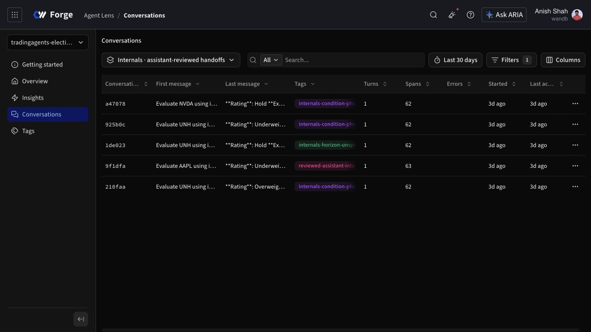

*The saved handoff view, captured November 9. Each row opens the original conversation and its span tree. The five cases are selected examples, not a representative failure-rate estimate. [Full-size image](assets/lens-reviewed-handoffs.png).*

The investigation gave us a concrete intervention for each finding. Preserve an entry condition in structured output or reject execution when it cannot be evaluated. Give every role the same as-of date, five-session mandate and benchmark. Provide actual starting holdings, or explicitly request a fresh-account allocation. Keep cash P&L, relative direction and abstention separate. We implemented and tested those contracts, then ran the development comparison below. Whether they improve future investment decisions still requires a registered forward window.

## Make the result and execution agree

One Agent Lens conversation represents a case, treatment, trial, and attempt. Its turn contains the research request and completed recommendation. Analysts, researchers, the trader, risk participants, and portfolio manager appear as subagents. Actual model and tool requests sit beneath them. Resuming an interrupted attempt keeps the conversation identity; a separate trial gets its own.

That bookkeeping matters when analysts run in parallel. If a tool span is attached to the wrong parent or a recommendation to the wrong trial, an attractive trace can be actively misleading. We propagate the context across parallel calls, preserve actual request and response content, close spans on errors, flush buffered traces, and record each model call's usage once. The optional integration uses the native [Forge Agent Lens tracing SDK](https://docs.coreweave.com/products/agent-lens/tracing/instrument), while preserving the existing Python and CLI decisions when tracing is disabled.

Weave's `EvaluationLogger` supplies the evaluation records through one compatibility adapter. The prediction context opens before the agent runs, so the evaluation Call IDs already exist. Each native span receives `weave.eval.run_id` and `weave.eval.predict_and_score_call_id`, as required by the [documented bridge](https://docs.coreweave.com/products/wandb/weave/guides/evaluation/evaluation_logger). Native tracing owns the model calls; implicit legacy instrumentation is disabled to prevent duplicate usage.

Hosted readback reconciled **360 trading conversations, 15,058 spans, and 4,149 campaign model calls**, including parentage, evaluation links, completion, and usage totals. All 360 agent runs and 600 other prediction records completed without execution failures. That establishes a working inspection path. The missing-news case explains why “completed” still needs a separate quality judgment.

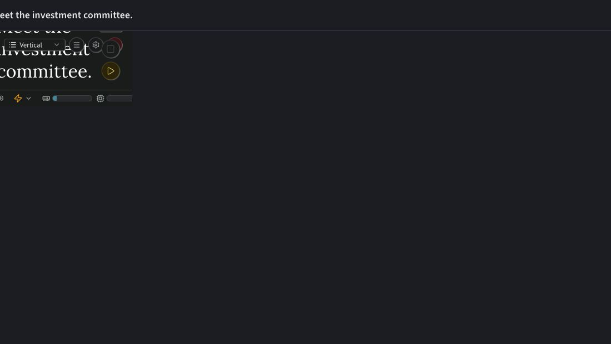

*The native [committee notebook](https://forge.coreweave.com/notebooks/Tm90ZWJvb2s6MTUyNjA%3D), captured November 6. All three hosted notebooks were saved, executed on their stored results, and reopened for verification. The campaign itself ran locally; the notebook button for starting a new paid agent run was not exercised. [Full-size image](assets/forge-notebook-roles.png).*

Cost and latency help decide which conversations deserve attention. The default committee averaged roughly 120 seconds and $0.038 in model charges per execution. All-Luna took about 118 seconds and $0.015; the single analyst about 18 seconds and $0.011. Those differences include changes in model, prompt objective, and evidence delivery, so they cannot isolate the cost of debate alone.

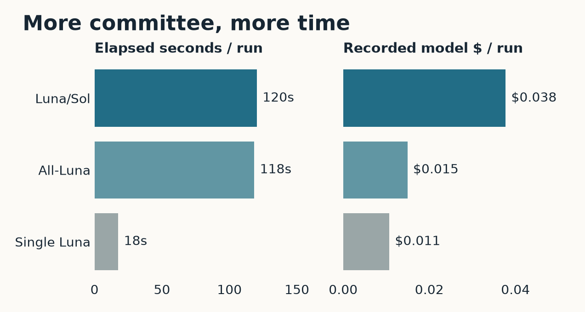

*120 executions per treatment. Model charges exclude infrastructure and unmetered local hardware. [Full-size image](assets/latency-and-model-cost.png).*

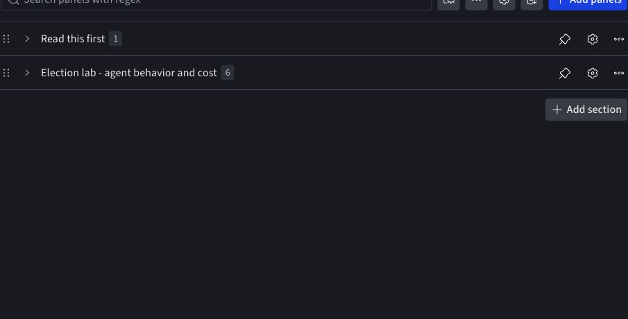

*The same saved operational records in the [behavior dashboard](https://forge.coreweave.com/wandb/wandb/tradingagents-election-lab?nw=oc6zwblxo0y), captured November 6. Its native panels below retain the original campaign filter. [Full-size image](assets/forge-behavior-dashboard.png).*

<!-- native-panel:behavior -->

## Give simpler methods a fair hearing

The numerical roster spans different assumptions. Twenty-session momentum extrapolates recent stock performance relative to SPY; five-session mean reversion predicts a reversal. AR(5) models daily relative returns from their five preceding values. Ridge and XGBoost predict delayed five-session excess return from 20 daily lags, with linear regularization and boosted trees respectively.

Our locally trained DLinear adaptation separates a moving-average component and residual, then fits a linear map to each. The [LTSF-Linear paper](https://arxiv.org/abs/2205.13504v3) motivated a simple neural baseline; our stock-return implementation is an adaptation, not a replication of its experiments. The pinned, 48-million-parameter [Chronos Bolt Small](https://huggingface.co/amazon/chronos-bolt-small) runs locally with 512 observations. Its historical pretraining exposure is unknown.

For fitted models, labels must mature before the cohort's first decision. Validation is chronological, with the final 20% held out and six examples purged at the boundary. Scaling uses training data only; hyperparameters are fixed before the evaluation cohort. The delayed entry also changes the forecast target: six future daily steps are needed, and the first step's return is excluded.

The original agent comparison has a material confound. The single analyst receives an explicit five-session, SPY-relative objective, while the committees retain the repository's recommendation prompts. Agents also receive SEC and macro evidence that numerical models do not, and the single analyst gets its bundle directly instead of retrieving it. We can compare these systems as configured. We cannot attribute their performance difference to the number of agents.

Buy and Overweight predict positive excess return; Underweight and Sell predict negative excess return. Hold abstains from directional accuracy. Signed excess return multiplies the direction by stock-minus-SPY return, so an Underweight can be correct even if the stock rose, provided SPY rose more.

| Method | Directional accuracy | Scored predictions | Mean signed excess return |
|---|---:|---:|---:|
| Default Luna/Sol committee | 36.4% | 77 | −1.30% |
| All-Luna committee | 28.4% | 81 | −1.42% |
| Single Luna analyst | 29.6% | 81 | −1.24% |
| 20-session momentum | 34.1% | 44 | −1.11% |
| Five-session mean reversion | 67.4% | 46 | +0.34% |
| AR(5) | 30.8% | 13 | −1.85% |
| Ridge regression | 58.6% | 29 | +1.01% |
| XGBoost | 52.0% | 25 | +0.21% |
| Locally trained DLinear | 58.6% | 29 | +0.21% |
| Chronos Bolt Small | 48.6% | 35 | −0.97% |

*Only successful, non-abstaining predictions with matured five-session outcomes. Each agent requested 120 predictions, including 24 pending; each numerical method requested 60, including 12 pending. Scored subsets differ. Passive methods make no directional forecast.*

Mean reversion's accuracy is appealing. Ridge's larger signed excess return shows why correct-call counts alone miss the size of moves. AR(5)'s 13 scored predictions describe a much narrower selection. The denominator belongs beside the score.

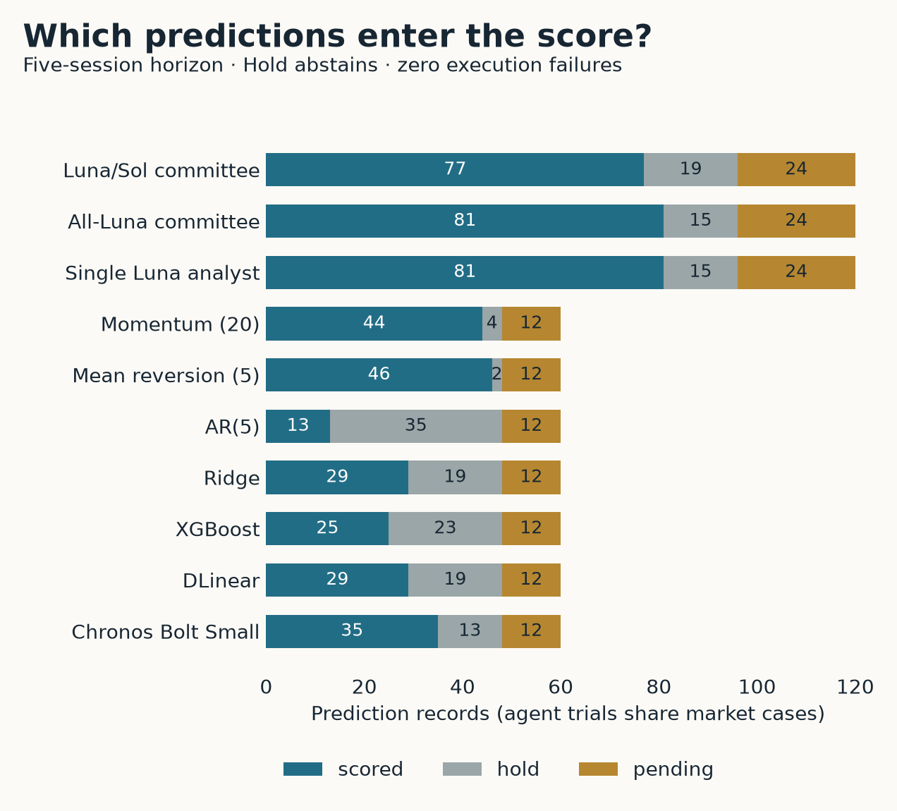

*Pending is classified first, so categories do not overlap. Agent records include two trials per case. [Exact denominators](../evidence/directional-denominators.csv). [Full-size image](assets/directional-denominators.png).*

For paired comparisons, we average trials within each stock/date case before subtracting scores. Default committee minus momentum is −0.33 percentage points across 41 matched cases. Its exploratory 95% cohort-block bootstrap interval is −1.25 to +0.74 points. With only four matured cohort blocks, that is a rough uncertainty check, not evidence of a dependable winner.

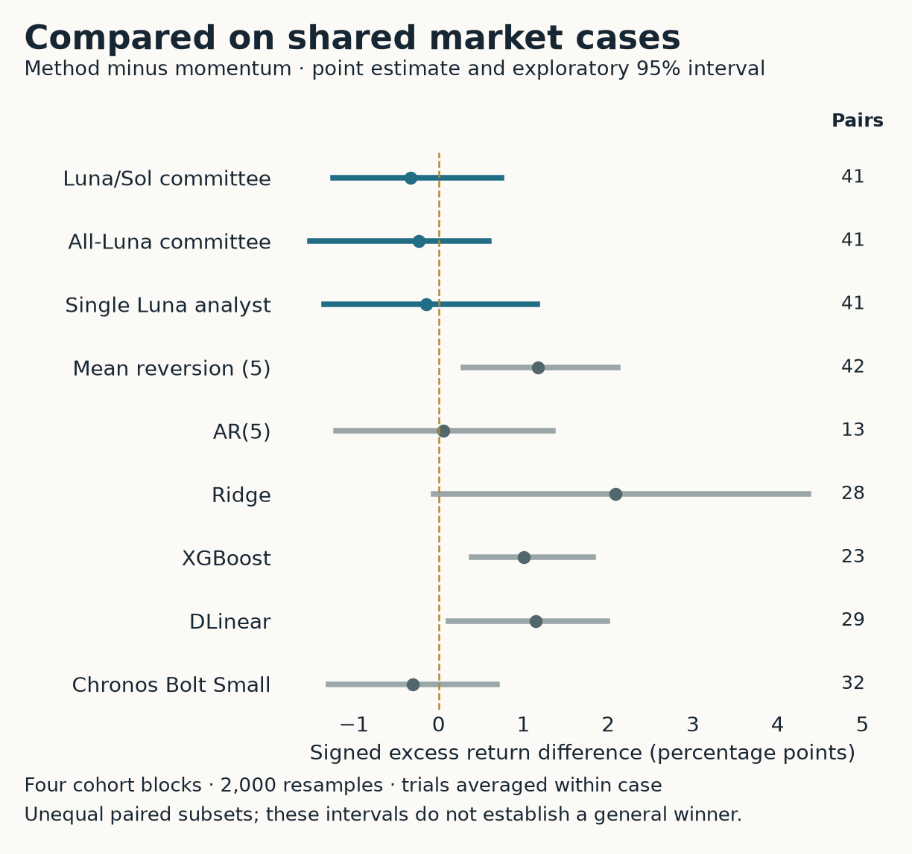

*2,000 cohort-block resamples, seed 2026. Paired subsets differ; no multiple-comparison correction. [All paired estimates](../evidence/paired-comparisons.csv). [Full-size image](assets/paired-uncertainty.png).*

The portfolio simulator translates those recommendations into dollars. Each fresh $100,000 scenario has six equal sleeves. Buy/Overweight/Hold/Underweight/Sell invest 100%/75%/50%/25%/0% of a sleeve; numerical forecasts use thresholds of −1%, −0.25%, +0.25%, and +1%. Sell leaves cash. Hold abstains from directional scoring but invests half a sleeve.

Entry is at the next session's close, followed by liquidation five sessions later. Fees fit inside the allocation so a fully invested sleeve does not borrow to pay them. Fractional shares, corporate actions, dividends, cash, and costs reconcile against fixtures. Overlapping scenarios stay independent; concatenating their equity curves would pretend the same capital could fund concurrent full-sized accounts.

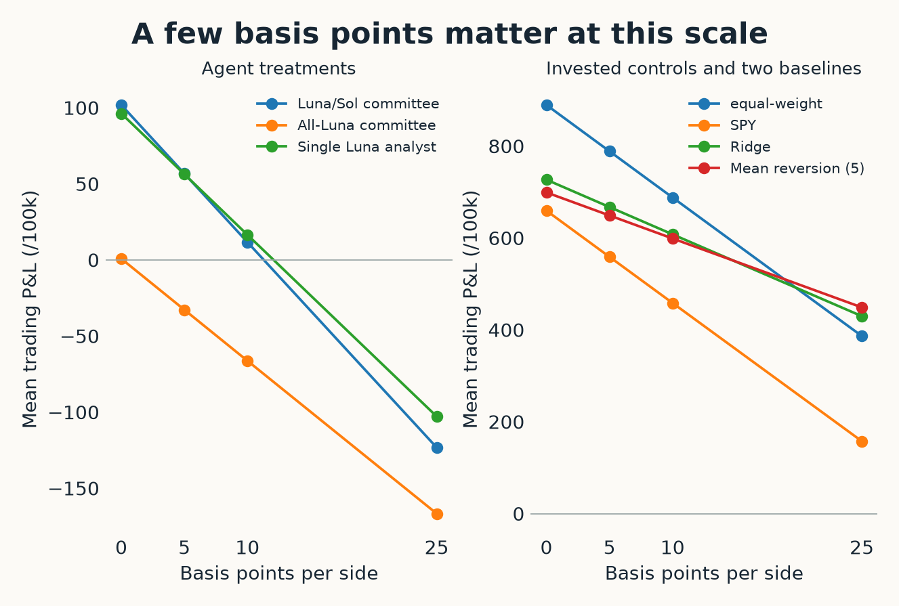

*Separate vertical scales; selected methods for readability. [All 13 fee sensitivities](../evidence/fee-sensitivity.csv) use the same matured scenarios. These fee assumptions do not estimate every historical spread or market impact. [Full-size image](assets/fee-sensitivity.png).*

I would take the promising simpler methods into a new window, rather than keep retuning this one. [Backtest-overfitting research](https://www.davidhbailey.com/dhbpapers/backtest-prob.pdf) explains why choosing a winner after inspecting many historical alternatives creates its own optimism. We did not estimate that paper's probability-of-overfitting measure. The practical consequence here is to keep this release frozen and register the next comparison before seeing its outcomes.

## Ask whether the result survives the trade

The original $458.44 SPY comparison invested much more capital than the committee. To make that objection concrete, we took the committee's invested fraction in each account and put exactly that fraction into SPY, leaving the rest as cash. We did the same with the equal stock basket. This preserves the committee's date and exposure choice while replacing its allocation across stocks. It matches invested capital, not beta, volatility, or drawdown risk.

For the default committee, the original mean trading profit is **$11.67**. The same-exposure SPY control makes **$156.15**, and the same-exposure stock basket **$262.78**. In this sample, the committee's stock allocations did not improve on those controls. The comparison remains descriptive: eight dates and four historical cohorts cannot settle whether the allocations would help elsewhere.

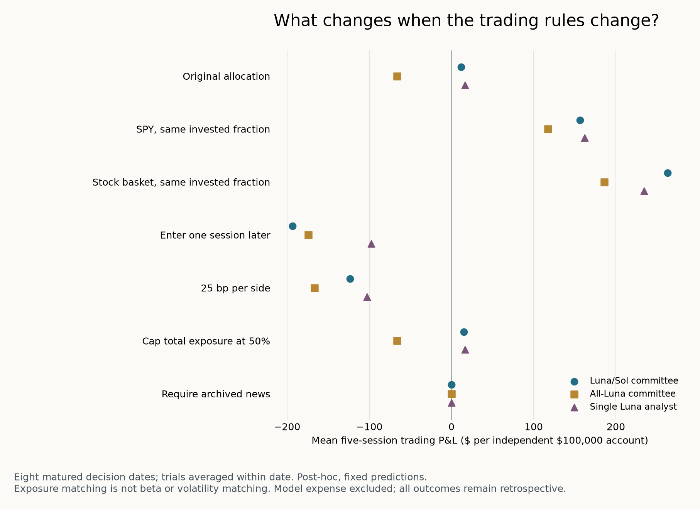

*Each dot averages trials within date, then the eight matured dates. Predictions and the November 5 freeze are unchanged. [Exact values for every method and profile](../trading-scenarios/summaries.csv). [Full-size image](assets/trading-scenario-sensitivity.png).*

Execution is less forgiving. Move entry to the second session's close and keep the five-session hold: the default committee averages **−$193.51**. The exit moves too, so this measures a different execution window, not the cost of a two-minute model call. At **25 basis points per side**, the original entry window averages **−$123.26**. That friction assumption is a stress test, not a measured historical spread or market-impact estimate.

A 50% exposure cap barely changes this committee's mean: **$15.13**, compared with $11.67 originally. It was already usually below the cap. We did not search many caps and select the most flattering one. The saved [scenario accounts](../trading-scenarios/scenario-results.csv) include exposure, turnover, costs, drawdown, and model expense so the cap can be evaluated for the constraint it enforces.

Requiring archived news leaves every agent account in cash, because every case lacks that source. Trading P&L is zero, and the model charges already incurred still count. That is an external deployment rule, not evidence that the agents voluntarily abstained. It exposes a real product decision: supply the event evidence, explicitly accept a narrower prices/SEC/macro mandate, or do not launch an event-driven trade.

The [scenario dashboard](https://forge.coreweave.com/wandb/wandb/tradingagents-election-lab?nw=71cv89hjh9u) keeps these analyses together. Open a method run's `scenario_accounts` table for the account and its constituent case IDs, then `case_links` for the original recommendation, evidence hash, and Agent Lens conversation. The native panels below show the same saved calculations. This keeps a dollar result connected to an actual agent execution, even when the portfolio rules are changed after the fact.

<!-- native-panel:scenarios -->

## We fixed the contract and ran it again

This time, every role received the same historical cutoff, exact entry and exit dates, five-session horizon, SPY benchmark and fresh-cash account. The final model call had to return an explicit allocation or abstain. An unsupported condition, wrong date or inconsistent weight leaves cash and receives no directional grade. The simulator checks the contract again before opening a position. The simulator executes that explicit order, so a rating alone can no longer authorize a position.

We froze that change before qualification, then ran all **60 cases × three treatments × two trials**. All 360 executions completed: 215 produced accepted orders and 145 explicitly chose cash. None failed or produced a rejected contract. Hosted readback verified **14,829 spans and 4,194 model calls**, including the common mandate in every recorded model request. The [frozen protocol, paired records and verification receipt](https://github.com/ash0ts/TradingAgents/tree/codex/tradingagents-forge-notebooks/studies/execution-contract-v2) preserve the original comparison alongside the new one. These are previously inspected development cases, not an untouched test.

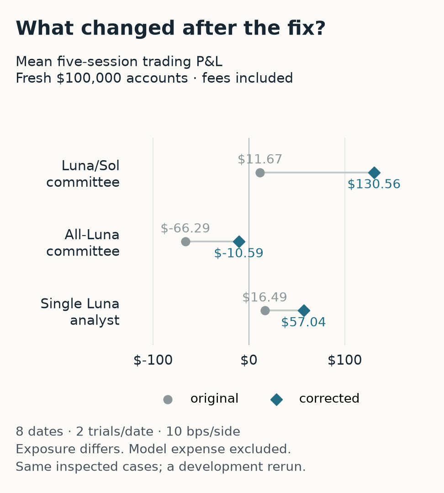

*Fresh $100,000 scenarios, eight matured dates, two trials per date and 10 basis points per side. Model expense is separate. The original numerical and passive baselines are unchanged. [Exact values and exposure](assets/corrected-portfolio-pnl.csv). [Full-size image](assets/corrected-portfolio-pnl.png).*

The default committee's average invested fraction fell from **45.0% to 20.3%**. Its directional accuracy rose from 36.4% on 77 graded predictions to 58.3% on 48. That is a smaller, different selection of calls, not the same predictions suddenly becoming more accurate. Its paired profit change is +$118.90 per account; the exploratory 95% cohort-block interval runs from **−$439.67 to +$677.46**. There are only four matured cohort blocks. All three treatments' intervals include zero, and all three still trail the fully invested SPY mean of $458.44 at different exposure levels.

The all-Luna committee's response was more revealing: **92 of its 120 decisions explicitly chose cash**. In several reviewed reports, it explained that the evidence did not establish a five-session edge over SPY. We opened the inputs. Our committee price tool is bound to the case ticker; it does not expose SPY prices. The single analyst gets SPY directly in its bundle. Asking the committees to defend a benchmark-relative trade made that inherited information-access difference harder to overlook. We cannot call their missing comparison an invented excuse, or attribute the treatment gap to the number of agents.

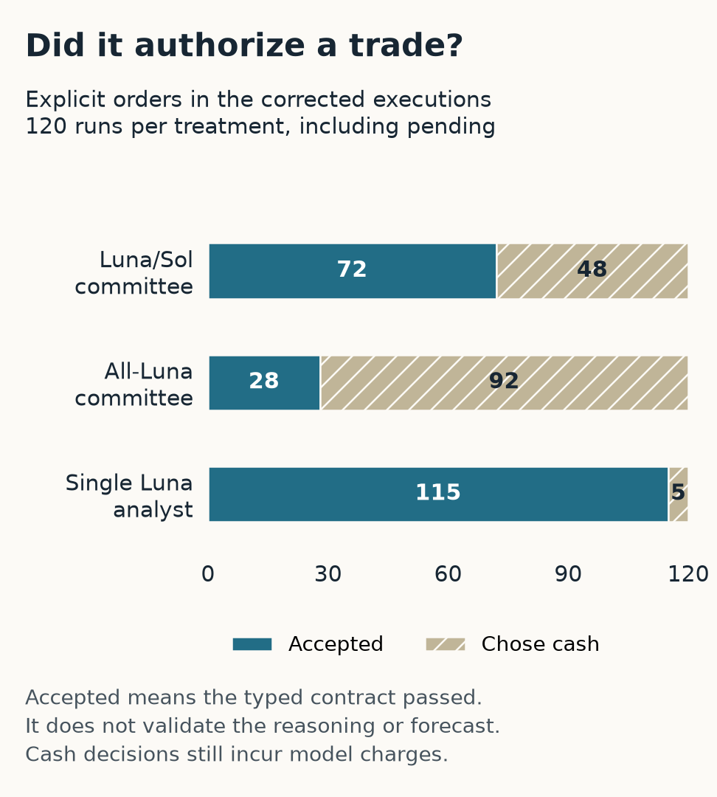

*Accepted means the typed execution contract passed. It does not certify the explanation or forecast. Cash choices still incur model charges, and pending outcomes are included in these operational counts. [Full-size image](assets/corrected-execution-status.png).*

Return to the original weakest UNH example. In the first corrected default trial, the final manager now explicitly allocates 25% at the November 8 close and exits November 15, without waiting for a breakout. It also corrects the trader's “Sell” label for that 25% sizing to “Underweight.” The other trial allocates 50%. Both are executable fresh-account decisions; neither tells us what the old, underspecified conditional strategy would have earned.

We reviewed the five discovered cases across both trials and all three treatments: **30 final outputs, reviewed by Codex rather than a domain expert**. Twenty-nine had consistent mandate/order prose within that review's scope. One single-analyst UNH report called its approximately $4,167 allocation “before entry fees,” although the 25% budget includes them. The simulator correctly invests about $4,162.50 plus $4.16 in fees. The typed order passed; that sentence still needs correction. We also did not certify every numerical or event claim in these reports. The [review records](https://github.com/ash0ts/TradingAgents/blob/codex/tradingagents-forge-notebooks/studies/execution-contract-v2/reviews.json) preserve those limits and the mismatch.

The [corrected-execution dashboard](https://forge.coreweave.com/wandb/wandb/tradingagents-election-lab?nw=zvy3sfqxpnd) separates profit, exposure, graded-call counts and model expense. Open a corrected run's `paired_decisions` table for the old and new Agent Lens conversations, or the updated [financial notebook](https://forge.coreweave.com/notebooks/Tm90ZWJvb2s6MTUyNzI%3D) to filter and download the pairs. Three native Agent Lens views isolate the new treatments. This gives us a repeatable loop: find a mismatch in an actual conversation, encode the contract, run the same cases again, and inspect what still fails.

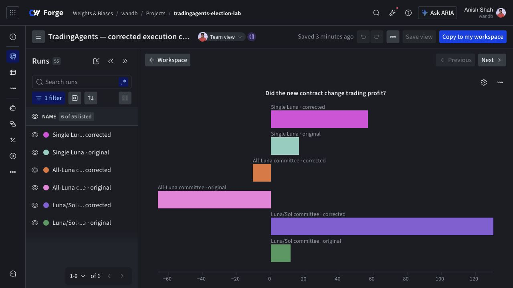

*The saved native profit panel, captured November 9 after the rerun. Horizontal values are mean dollars per fresh $100,000 scenario; the paired figure above gives exact amounts. [Full-size image](assets/forge-corrected-dashboard.png).*

<!-- native-panel:corrected -->

## Open the evidence, then decide what to change

The [trading evidence package](../evidence/tradingagents-public-evidence.zip) contains 960 predictions, 2,880 horizon scores, 640 portfolio scenarios, source coverage, paired comparisons, selected reviews, and a hash manifest. The [reproduction guide](../evidence/README.md) defines the joins, units, and access limits. The [scenario extension](../trading-scenarios/README.md) supplies another 1,120 reconciled accounts and the inputs required to rebuild them without a model call or licensed raw quotes.

The [internals audit](../internals/README.md) adds 360 derived observation rows and five selected reviews without changing those original records. Its native dashboard contains the result-to-conversation links, and its public exports contain the check definitions, short reviewed excerpts and source hashes. This pass made no new model or judge calls.

The original trading qualification and campaign recorded **$7.683182 in model charges**. The corrected qualification and campaign add **$7.783134**. Including $0.001853 from an excluded prototype, total known model charges are **$15.468169**. A separate **$175 infrastructure reservation** remains held against the **$250 cap**, awaiting invoice reconciliation. Known or reserved spend is **$190.468169**. Local training hardware is unmetered. Publication reuses saved results.

The three Forge Notebooks remain practical workspaces: [meet the committee](https://forge.coreweave.com/notebooks/Tm90ZWJvb2s6MTUyNjA%3D), [investigate its behavior](https://forge.coreweave.com/notebooks/Tm90ZWJvb2s6MTUyNzE%3D), and [compare financial outcomes](https://forge.coreweave.com/notebooks/Tm90ZWJvb2s6MTUyNzI%3D). This single article supplies the narrative across them. The code remains in six dependent draft PRs in the personal fork, with no Forge or Agent Lens product changes.

The execution contract is now implemented and its development results are visible. Before a forward study, we still need matched benchmark access, an explicit policy for missing event evidence, and broader factual review. The useful outcome is a trading experiment whose instructions, orders and scores can be challenged all the way down to the recorded request. Eight historical dates still do not tell me to hand it the money.
