# Would you give this investment committee money?

A UNH recommendation lost **$1,153.72** in our simulation. The agent had asked us to wait for confirmation before buying. We bought anyway.

That was an awkward result to find while investigating whether an AI investment committee deserved its fees. We had given [TradingAgents](https://github.com/ash0ts/TradingAgents) analysts, opposing researchers, a trader, a risk discussion and a portfolio manager. Across eight historical decision dates, the default committee averaged **$11.67 in trading profit** per simulated $100,000 account. Buying SPY averaged **$458.44**. The committee produced considerably more meeting notes.

Opening those notes changed the question. Our simulator had discarded the condition attached to the recommendation. After we fixed that contract, the cheaper committee often chose cash because it could not establish an edge over SPY. Fair enough: its price tool did not expose SPY. Then we found a trader prompt that explicitly translated “Underweight” into “Sell,” even though our allocation rules gave those words different meanings.

This is the experiment, including the repairs ([companion repository](https://github.com/ash0ts/TradingAgents/tree/forge-showcase-v1)). Our replay ran `gpt-6-luna` and `gpt-6-sol` instrumented with the Forge SDK (and the lab runner now also runs open models directly on [Forge Inference](https://forge.coreweave.com/inference/models)). [Agent Lens](https://docs.coreweave.com/products/agent-lens) lets us follow a dollar result into the actual analyst reports, model requests and tool responses, while CoreWeave Forge holds the traces, EvalTables, Weave Evaluations, saved Notebooks, dashboards and versioned evidence so each rerun keeps the earlier trial visible. The questions are the ones an investor would recognize: did stock selection help, did cash protect the account, did the order match the advice, and was there enough evidence to trade at all?

The final 720-attempt study changed the ranking again—and two weeks later, the sealed November 2026 midterm window matured out of sample. In the eight-date replay, the single analyst fell behind the full committee, yet the committee chose the same allocation across three fresh runs in only **22 of 60 cases** and every planned contrast crossed zero. When the 2026 midterm five-session closes arrived, the multi-step workflows beat the single analyst on directional calls (`62.5%`–`70.0%` vs. `31.3%`) while still trailing matched-exposure SPY in dollars. We had made the orders inspectable and executable. We still had a fairly opinionated position-sizing machine.

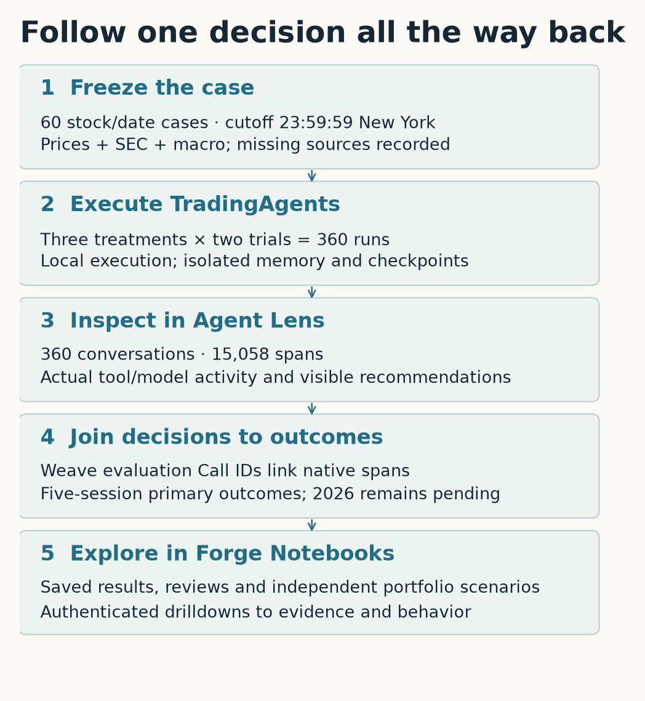

*The implemented trading workflow. Each stage preserves the identity of the case and execution.*

## Start with a result you can investigate

The [financial dashboard](https://forge.coreweave.com/wandb/wandb/tradingagents-election-lab?nw=0q277wzs5up) and [comparison notebook](https://forge.coreweave.com/notebooks/Tm90ZWJvb2s6MTUyNzI%3D) contain all 13 methods. Each decision date starts a fresh $100,000 scenario at 10 basis points per side; the numbers throughout are descriptive scenario averages rather than compounded equity curves, and API model expense is tracked separately from trading P&L.

*Eight matured historical decision dates (two trials per date for agents; one for deterministic and passive methods). Exposure differs: the default committee averaged about 45% invested, versus almost 100% for SPY. [Exact figure data](assets/portfolio-pnl.csv).*

A low bar is easy to clear if we call every passive alternative “doing nothing.” Cash earns zero interest in this simulator. Buying SPY and waiting is another choice; buying the six-stock basket is a third. The default committee barely beat idle cash and trailed both invested controls. A dashboard that showed only the cash comparison would make an excellent sales slide and a rather incomplete experiment.

To investigate any row, open the saved notebook, follow its Agent Lens conversation link, select an analyst in the span tree, and inspect the model and tool activity beneath it. The notebook also preselects the strongest result, weakest result, and a fixed-seed random example so the tour doesn't consist solely of whichever anecdote makes our point neatest. Public readers get sanitized tables and captures; live Agent Lens conversation drilldowns require team access.

> **Interactive Forge Workspace view:** [Open the financial comparison panels in CoreWeave Forge](https://forge.coreweave.com/wandb/wandb/tradingagents-election-lab?nw=0q277wzs5up).

The November 3, 2026 midterm election supplied the premise and a real forward deadline. All campaign snapshots freeze market data through **November 5, 2026**, leaving the eight older dates matured during development and keeping the 12 current-midterm cases sealed until their five-session closes arrived on November 10 and November 12. We follow the original freeze through the engineering repairs first, then score those sealed midterm calls at the end.

## Open the worst trade before blaming the committee

We started with UNH on November 7, 2022, trial 1 of the default committee: the original weakest example by signed excess return. Its Overweight landed on the wrong side of a **13.36-percentage-point** move relative to SPY, losing **$1,153.72** after fees on that one sleeve within the $100,000 account.

The [internals dashboard](https://forge.coreweave.com/wandb/wandb/tradingagents-election-lab?nw=dufjini1rvb) links that sleeve directly to its Agent Lens conversation. Following the Research Manager, Trader and Portfolio Manager in the span tree exposes what happened at the handoff:

| Stage | What the saved output says or does |
|---|---|
| Research Manager | Overweight; build a modest position gradually and seek more evidence before increasing it |
| Trader | Buy, but “favor adding only on confirmation above that zone” |
| Portfolio Manager | Overweight; “favor a modest, conditional increase rather than an immediate full-size buy” |
| Our simulator | Invest 75% of a fresh sleeve at the next session's close, then hold five sessions |

The final report kept the breakout condition; our simulator consumed the headline rating and threw the condition, stop, and staged entry away. We could reproduce the $1,153.72 loss to the cent while failing to simulate the trade written in the prose. Whether an executable breakout rule would have made money is unknown without defining its trigger and expiry—so we left the historical score untouched and logged the mismatch as a regression case.

Reading the prompt inputs exposed a second bug. The portfolio manager is told that holdings and cash were not provided and to “not assume a flat book,” while our simulator starts every account 100% in cash. The agent's “trim an existing position” and our “open a smaller new position” shared an Underweight label while describing different trades; in the seeded-random AAPL case, the trader's Sell explicitly meant a partial trim “rather than exiting outright.”

Checking all 360 saved outputs showed that UNH wasn't an isolated quirk. A simple phrase scan found conditional wording candidates in **81/120 default-committee** and **45/120 all-Luna** reports, and the final horizon field literally read “not provided” in **58/120** and **16/120** reports respectively.

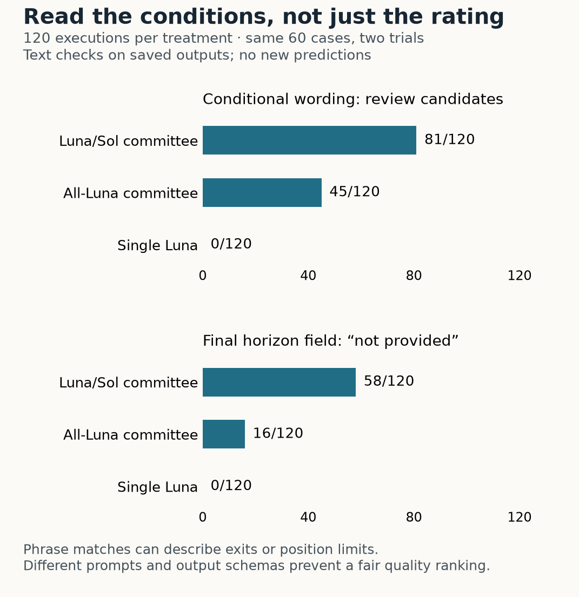

*Checks on original saved outputs ([all 360 rows and definitions](https://github.com/ash0ts/TradingAgents/blob/forge-showcase-v1/articles/internals/README.md)). The single analyst uses a compact one-shot prompt rather than the multi-stage template.*

> **Interactive Forge Workspace view:** [Open the internals contract-check panels in CoreWeave Forge](https://forge.coreweave.com/wandb/wandb/tradingagents-election-lab?nw=dufjini1rvb).

## Did the risk discussion change its mind?

Within each committee run, the Research Manager's recommendation and the final Portfolio Manager rating matched in **238 of 240 executions** (`118/120` default committee, `120/120` all-Luna). That check starts after the bull/bear debate and misses sizing or prose qualifications, so both exceptions are worth opening. For NVDA right after the 2024 election (trial 2), Overweight moved to Hold because the evidence couldn't establish “today's risk-reward.” For UNH after the 2023 control date (trial 1), Underweight moved to Hold because historical readings couldn't establish “current downside risk.” Inside a historical replay, both stages slipped into advising someone trading in the present.

That gave us a concrete state-handoff bug: the decision date, five-session holding period, SPY benchmark and flat-cash starting book had to survive every role prompt. Even our strongest directional win showed the same drift: UNH after the 2025 control date scored **+5.39 percentage points** of signed excess return (losing **$203.27** in cash on a quarter-invested sleeve as the stock fell, though less than SPY), yet its prose named “the next earnings and guidance update” as its horizon rather than five sessions. The [five selected trace reviews](https://github.com/ash0ts/TradingAgents/blob/forge-showcase-v1/articles/internals/reviews.json) preserve the exact excerpts and automated LLM review checks behind those findings.

## What the committee was allowed to know

The [TradingAgents paper](https://arxiv.org/abs/2412.20138v7) organizes specialists, bull/bear researchers, a trader, and risk analysts into a structured committee. Our fork keeps that multi-agent graph while changing the models, dates, evidence cutoff, and evaluation rules.

We tested six stocks—AAPL, MSFT, NVDA, JPM, XOM, and UNH—on the trading sessions immediately before and after five calendar anchors, with SPY as the benchmark:

| Cohort | Anchor | Status at Nov 5, 2026 freeze | Status on Nov 16, 2026 |
|---|---|---|---|
| Previous midterms | November 8, 2022 | Matured | Matured |
| Calendar control | September 12, 2023 | Matured | Matured |
| Previous presidential election | November 5, 2024 | Matured | Matured |
| Calendar control | September 9, 2025 | Matured | Matured |
| Current midterms | November 3, 2026 | Pending (sealed) | Matured (Nov 10 & 12 closes) |

Sixty stock/date cases across three initial LLM setups (the default Luna/Sol committee, an all-Luna committee, and a single Luna analyst) at two trials per case gave 360 agent executions alongside 600 baseline records. Macro events also overlap those election windows—the [November 10, 2022 CPI print](https://www.bls.gov/news.release/archives/cpi_11102022.htm) and the [November 7, 2024 Fed rate cut](https://www.federalreserve.gov/newsevents/pressreleases/monetary20241107a.htm) both fell inside the five-session holds—so four historical blocks cannot isolate a pure “election effect.”

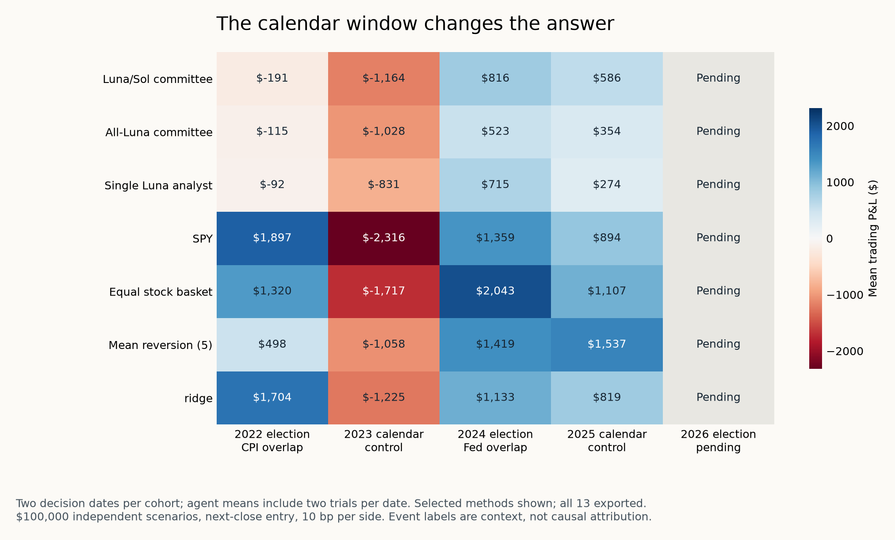

*Mean profit across two decision dates per cohort at the November 5 freeze ([all 13 methods exported](https://github.com/ash0ts/TradingAgents/blob/forge-showcase-v1/articles/trading-scenarios/cohort-breakdown.csv); [per-stock contributions](https://github.com/ash0ts/TradingAgents/blob/forge-showcase-v1/articles/trading-scenarios/stock-contributions.csv)). Staying partly in cash softened the 2023 drawdown (`−$1,164` default committee vs. `−$2,316` SPY) and muted the 2024 rally (`+$816` vs. `+$1,359` SPY).*

Information for every case closes at `23:59:59 America/New_York` on the decision date; entry occurs at the next trading session's close and exits five sessions later (with 1- and 20-session horizons logged as secondary). Frozen bundles supply prices, corporate actions, vintage-dated SEC company facts, and ALFRED macroeconomic releases. Because we lacked licensed historical news or social archives, network guards blocked live web lookups and missing text tools returned explicit unavailability—making this a retrospective prices/SEC/macro replay rather than a live-news test like [Agent Market Arena](https://arxiv.org/abs/2510.11695v2). Nor can frozen bundles erase what a 2026 model remembers about 2022–2025 from pretraining, which is why the sealed November 2026 cohort matters.

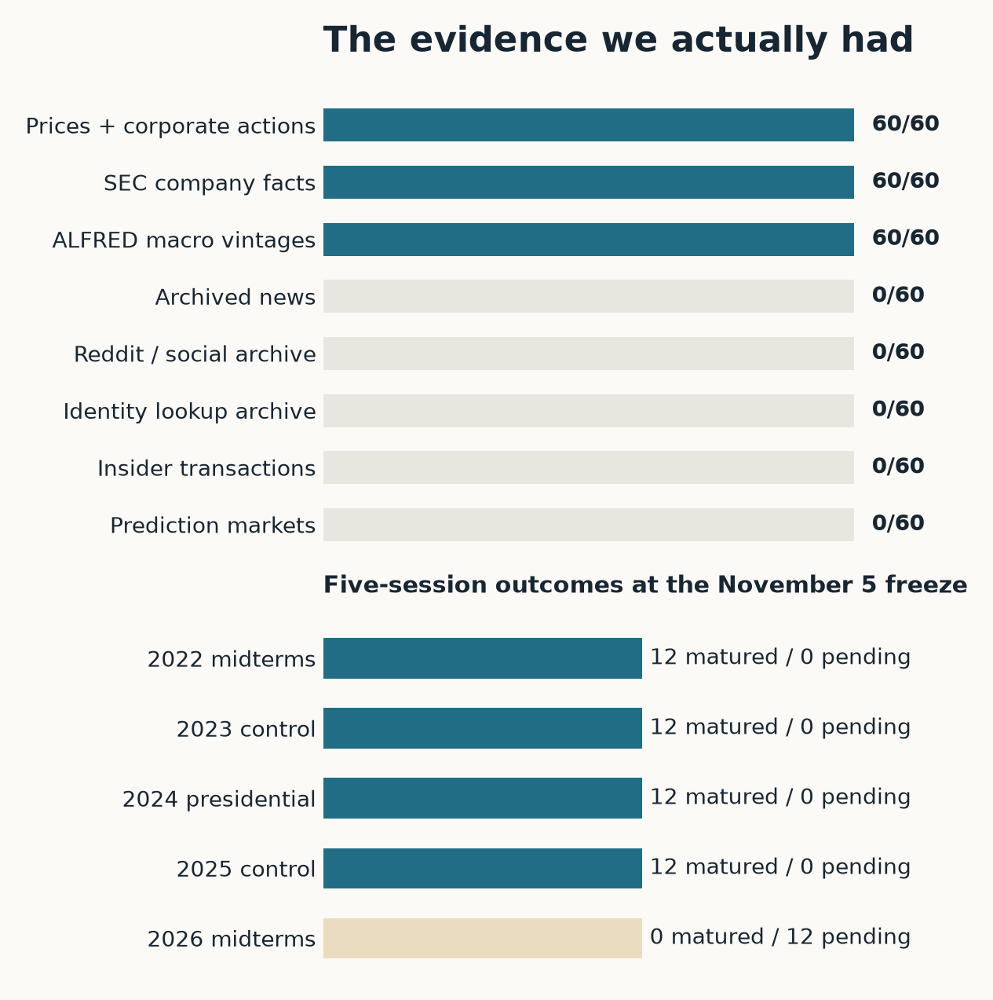

*Source availability and outcome maturity at the November 5 freeze ([full coverage table](https://github.com/ash0ts/TradingAgents/blob/forge-showcase-v1/articles/evidence/source-coverage.csv)).*

## Follow the missing news—and check our own detectors

In the UNH run right before the 2026 midterms, `get_news` returned `DATA_UNAVAILABLE` and the committee still finished cleanly. Opening the span tree in Agent Lens separates an execution crash from an evidence-coverage gap: the tool had no archive to return, replay kept that absence intact, and the analyst report noted the missing feed rather than inventing headlines.

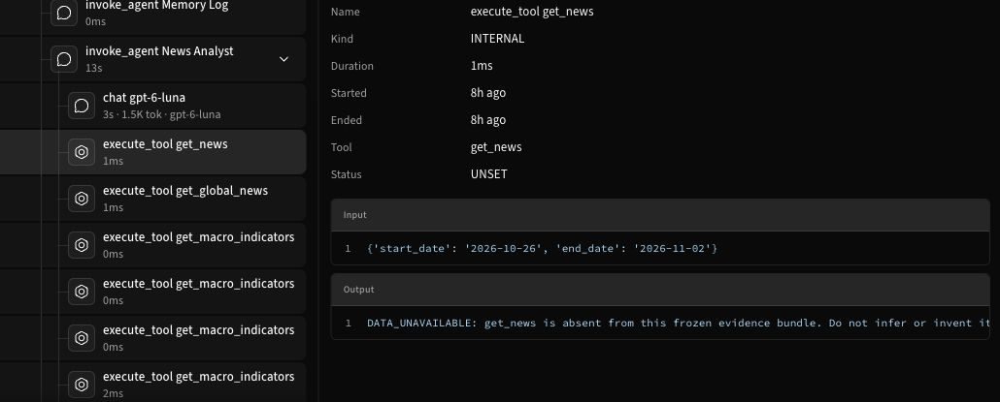

*Agent Lens tool details from the November 2, 2026 UNH run showing the requested window and `DATA_UNAVAILABLE` response.*

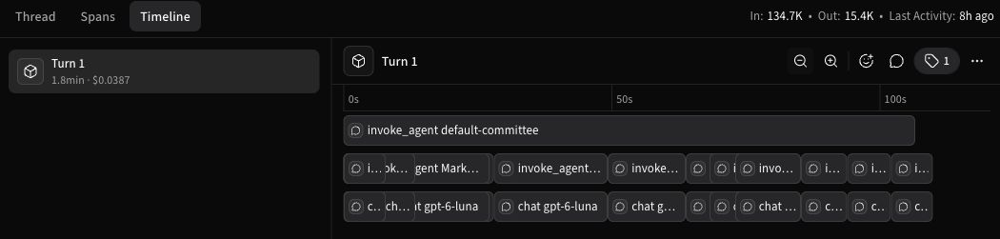

*The full turn timeline for UNH trial 0, where parallel analyst calls fan out beneath the committee root.*

Our own deterministic failure flags needed the same skepticism. Across 360 runs, rule checks flagged 240 missing-tool-evidence turns (every committee run whose tools hit unavailable text feeds), five missing-acknowledgment candidates, two unavailable-evidence-as-fact candidates, one repeated tool call, and one unsupported-price candidate. When we ran an automated LLM audit over six flagged candidates, **five turned out to be false positives in our regex rules**: one UNH report acknowledged missing news with the verb “lacks,” and an AAPL report discussed a hypothetical breakout price inside an explicit “if” clause.

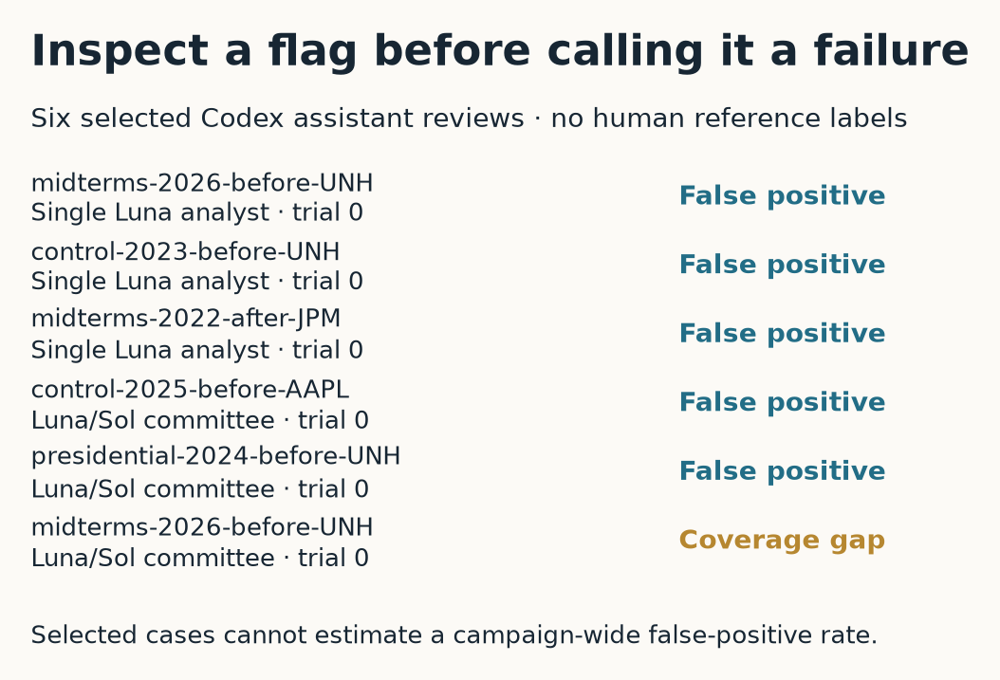

*Six audited rule flags ([rationales and digests](https://github.com/ash0ts/TradingAgents/blob/forge-showcase-v1/articles/evidence/assistant-reviews.csv)). Following Anthropic's [agent-evaluation guidance](https://www.anthropic.com/engineering/demystifying-evals-for-ai-agents), we kept candidate flags separate from confirmed regressions in the [investigation notebook](https://forge.coreweave.com/notebooks/Tm90ZWJvb2s6MTUyNzE%3D).*

## Use Insights when it has volume; use Saved Views when it does not

When we opened the project's [Agent Lens Insights](https://docs.coreweave.com/products/agent-lens/insights) tab on November 9, no clustering run had fired. Evaluation-linked spans are excluded from Insights classification, and forming sub-topic clusters requires at least **100 classified signatures** in the 7-day window (plus **15 distinct wordings** in an eligible category; see [Where Do Agent Lens Insights Come From?](https://forge.coreweave.com/wandb/wandb/agent-lens-fc/reports/Where-Do-Agent-Lens-Insights-Come-From--VmlldzoxNzk5OTk0NA==)).

Checking again on November 10 produced a classic small-denominator trap: Insights read **“Missed requirement — 100% of turns.”** Its denominator was **one turn**—a synthetic arithmetic probe we had emitted to test span-journal recovery, not a TradingAgents run. We excluded that fixture from every study count ([status receipt](https://github.com/ash0ts/TradingAgents/blob/forge-showcase-v1/studies/debate-ablation-v5/insights-status.json)) and created three Saved Views on the [internals dashboard](https://forge.coreweave.com/wandb/wandb/tradingagents-election-lab?nw=dufjini1rvb) instead: **conditional wording candidates**, **explicit missing horizon**, and **assistant-reviewed handoffs**.

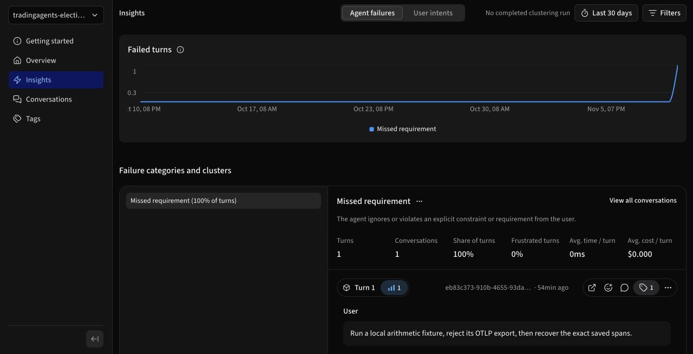

*Always check the denominator: one synthetic trace-recovery probe produced a 100% banner with zero completed clusters.*

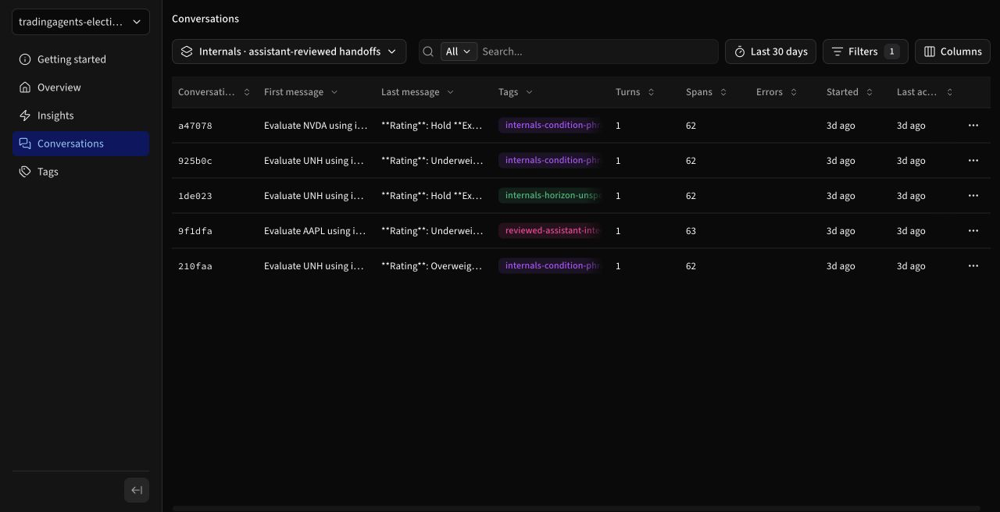

*Saved View filtering directly to the five audited handoff conversations and their span counts.*

## Make the trace and evaluation identifiers agree

In our [Agent Lens instrumentation](https://docs.coreweave.com/products/agent-lens/tracing/instrument), one conversation maps to `(case, treatment, trial, attempt)`, with analysts, researchers, trader, risk participants and portfolio manager nested as subagent spans beneath the turn. Propagating span context across parallel analyst threads keeps tool calls attached to the analyst that actually invoked them. Before an agent starts, Weave's [`EvaluationLogger`](https://docs.coreweave.com/products/wandb/weave/guides/evaluation/evaluation_logger) opens the prediction record and stamps `weave.eval.run_id` and `weave.eval.predict_and_score_call_id` onto the native spans while legacy auto-patching stays off so token usage is counted once.

Hosted readback across the initial campaign reconciled **360 trading conversations, 15,058 spans, and 4,149 model calls** with zero execution crashes. The default committee averaged ~120 seconds and `$0.038` per run before cache-write adjustments, all-Luna ~118 seconds and `$0.015`, and the single analyst ~18 seconds and `$0.011`.

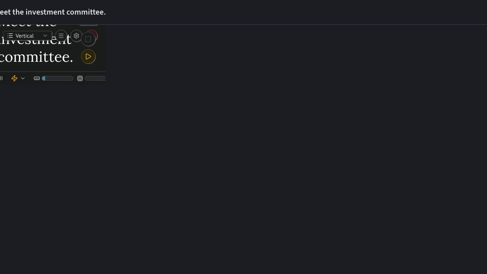

*The saved [committee notebook](https://forge.coreweave.com/notebooks/Tm90ZWJvb2s6MTUyNjA%3D) in Forge Notebooks.*

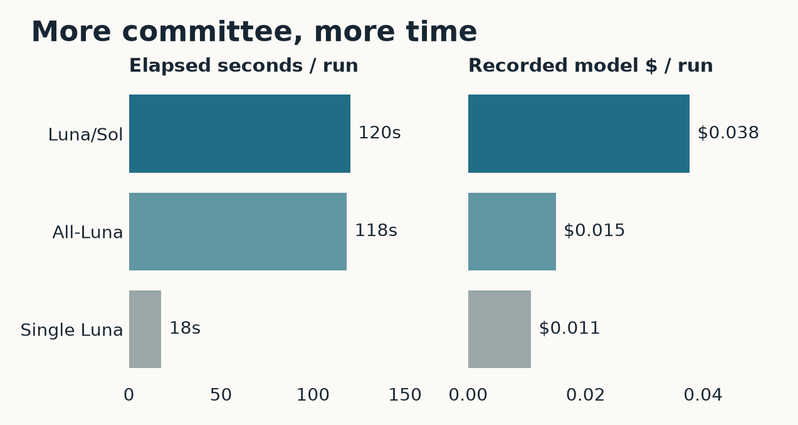

*120 executions per treatment (initial list-price estimates prior to the cache-write adjustment below).*

> **Interactive Forge Workspace view:** [Open the operational behavior panels in CoreWeave Forge](https://forge.coreweave.com/wandb/wandb/tradingagents-election-lab?nw=oc6zwblxo0y).

## Give simpler methods a fair hearing

Before tuning prompts, we benchmarked simpler forecasters under chronological purged splits (final 20% held out for validation, six examples purged at the boundary, scaling fit on training rows only, and delayed six-step targets matching next-close entry): 20-session momentum, 5-session mean reversion, AR(5), Ridge regression, XGBoost, a locally trained [LTSF-Linear (`DLinear`)](https://arxiv.org/abs/2205.13504v3) adaptation, and 48M-parameter [Chronos Bolt Small](https://huggingface.co/amazon/chronos-bolt-small). Note one fairness gap in the initial agent prompts: the single analyst received an explicit five-session SPY-relative mandate and inline SPY prices, whereas the committees inherited the repo's open-ended stock prompt.

Buy and Overweight predict positive excess return over SPY (`100%` and `75%` sleeve weights); Underweight and Sell predict negative excess return (`25%` and `0%`); Hold abstains from directional grading while investing `50%` of a sleeve. Numerical forecasts map onto those five buckets at `−1%`, `−0.25%`, `+0.25%`, and `+1%`:

| Method | Directional accuracy | Scored predictions | Mean signed excess return |
|---|---:|---:|---:|
| Default Luna/Sol committee | 36.4% | 77 | −1.30% |
| All-Luna committee | 28.4% | 81 | −1.42% |
| Single Luna analyst | 29.6% | 81 | −1.24% |
| 20-session momentum | 34.1% | 44 | −1.11% |
| Five-session mean reversion | 67.4% | 46 | +0.34% |
| AR(5) | 30.8% | 13 | −1.85% |
| Ridge regression | 58.6% | 29 | +1.01% |
| XGBoost | 52.0% | 25 | +0.21% |
| Locally trained DLinear | 58.6% | 29 | +0.21% |
| Chronos Bolt Small | 48.6% | 35 | −0.97% |

*Matured non-Hold predictions at the November 5 freeze (out of 120 requested per agent and 60 per numerical model, with 24 and 12 pending in 2026).*

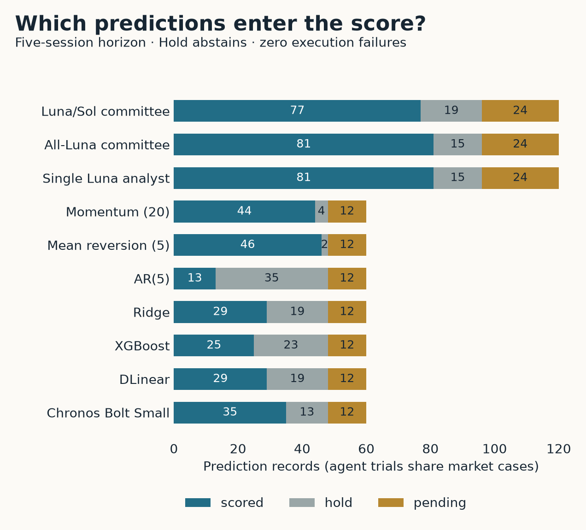

*Denominators beside accuracy ([CSV](https://github.com/ash0ts/TradingAgents/blob/forge-showcase-v1/articles/evidence/directional-denominators.csv)): Ridge's `+1.01%` signed excess return on 29 calls and mean reversion's `67.4%` hit rate on 46 calls both beat the unaligned committees.*

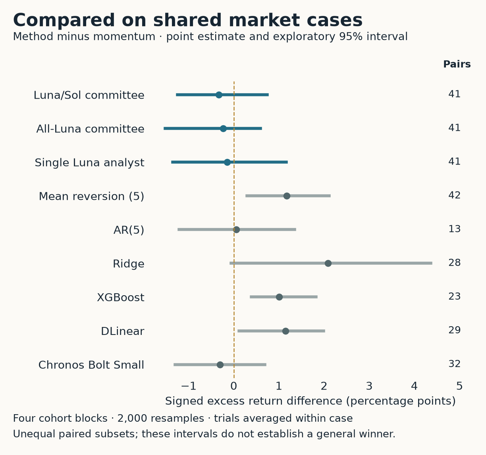

*Paired differences vs. 20-session momentum using 2,000 cohort-block bootstrap resamples across the four historical blocks ([all pairs](https://github.com/ash0ts/TradingAgents/blob/forge-showcase-v1/articles/evidence/paired-comparisons.csv)). Default committee minus momentum is `−0.33 pp` (`−1.25` to `+0.74`).*

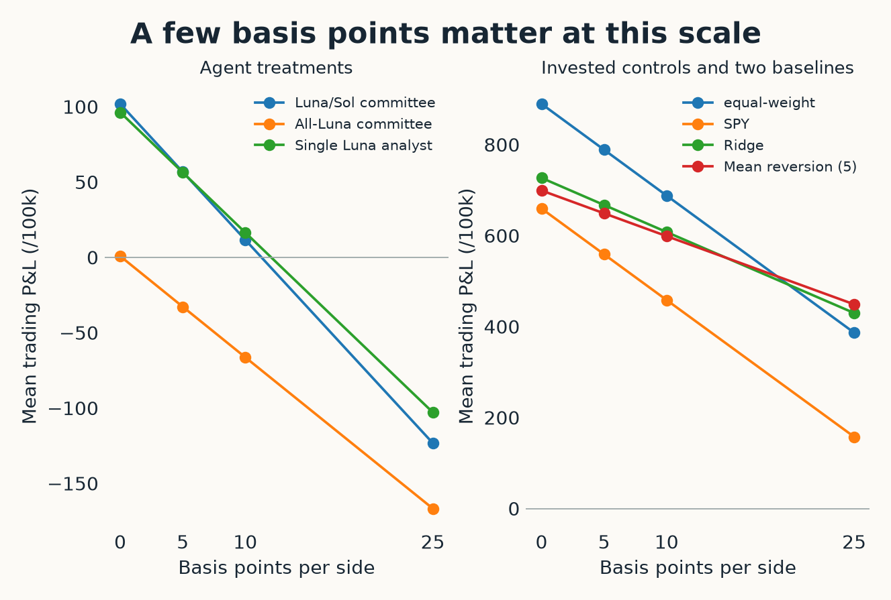

*Trading-fee sensitivity across `0`, `5`, `10`, and `25` bps per side ([full table](https://github.com/ash0ts/TradingAgents/blob/forge-showcase-v1/articles/evidence/fee-sensitivity.csv)). Consistent with [backtest-overfitting research](https://doi.org/10.21314/jcf.2016.322), retuning thresholds on these same eight dates would mostly manufacture hindsight.*

## Ask whether the result survives the trade

Because the `$458.44` SPY benchmark invested nearly `100%` of capital against the default committee's `45%`, practitioners reasonably ask—as threads in [r/algotrading on event sizing](https://www.reddit.com/r/algotrading/comments/1t6u14f/how_do_you_work_with_earnings/) and [concurrent backtest exposure](https://www.reddit.com/r/algotrading/comments/1qr4abm/position_sizing_for_backtesting/) regularly point out—how much came from cash drag versus stock picking, delayed fills, or fee friction. We replayed all 60 cases and 13 methods across seven post-hoc account profiles (`1,120` account scenarios: `896` matured at the Nov 5 freeze, `224` pending; [full scenario bundle](https://github.com/ash0ts/TradingAgents/blob/forge-showcase-v1/articles/trading-scenarios/trading-scenarios-evidence.zip)). Matching invested capital replaces stock selection while keeping date and cash fraction fixed (it does not equalize beta or volatility):

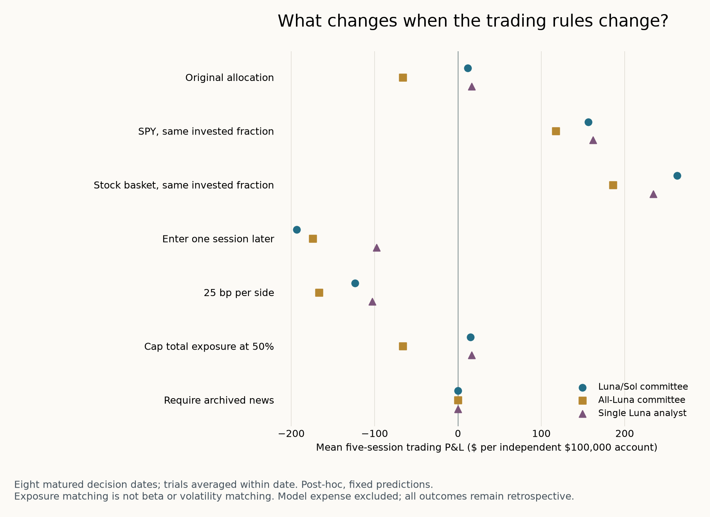

*Seven execution profiles across the eight matured dates ([exact summaries](https://github.com/ash0ts/TradingAgents/blob/forge-showcase-v1/articles/trading-scenarios/summaries.csv) and [account rows](https://github.com/ash0ts/TradingAgents/blob/forge-showcase-v1/articles/trading-scenarios/scenario-results.csv)).*

Against the default committee's **`$11.67`**, putting its exact invested fraction into SPY earned **`$156.15`** and into the equal six-stock basket earned **`$262.78`**—so cash drag wasn't the committee's only problem. Delaying entry by one extra session dropped the mean to **`−$193.51`**, raising friction to `25` bps dropped it to **`−$123.26`**, capping account exposure at `50%` nudged it to **`$15.13`**, and an external deployment gate refusing event trades without archived news held `100%` cash (`$0` trading P&L, minus model fees already spent).

> **Interactive Forge Workspace view:** [Open the scenario-sensitivity panels in CoreWeave Forge](https://forge.coreweave.com/wandb/wandb/tradingagents-election-lab?nw=71cv89hjh9u).

## We fixed the contract and ran it again

For `execution-contract-v2`, every role received the identical cutoff, exact entry/exit dates, five-session horizon, SPY benchmark, and flat `$100,000` cash book, and the Portfolio Manager had to emit a typed order or explicit cash abstention (any unexecutable condition or date mismatch defaults to cash). Across all **360 rerun executions** (`60 cases × 3 treatments × 2 trials`; `14,829` verified spans and `4,194` model calls in [`studies/execution-contract-v2`](https://github.com/ash0ts/TradingAgents/tree/forge-showcase-v1/studies/execution-contract-v2)), `215` orders passed and `145` explicitly chose cash, with zero contract rejections.

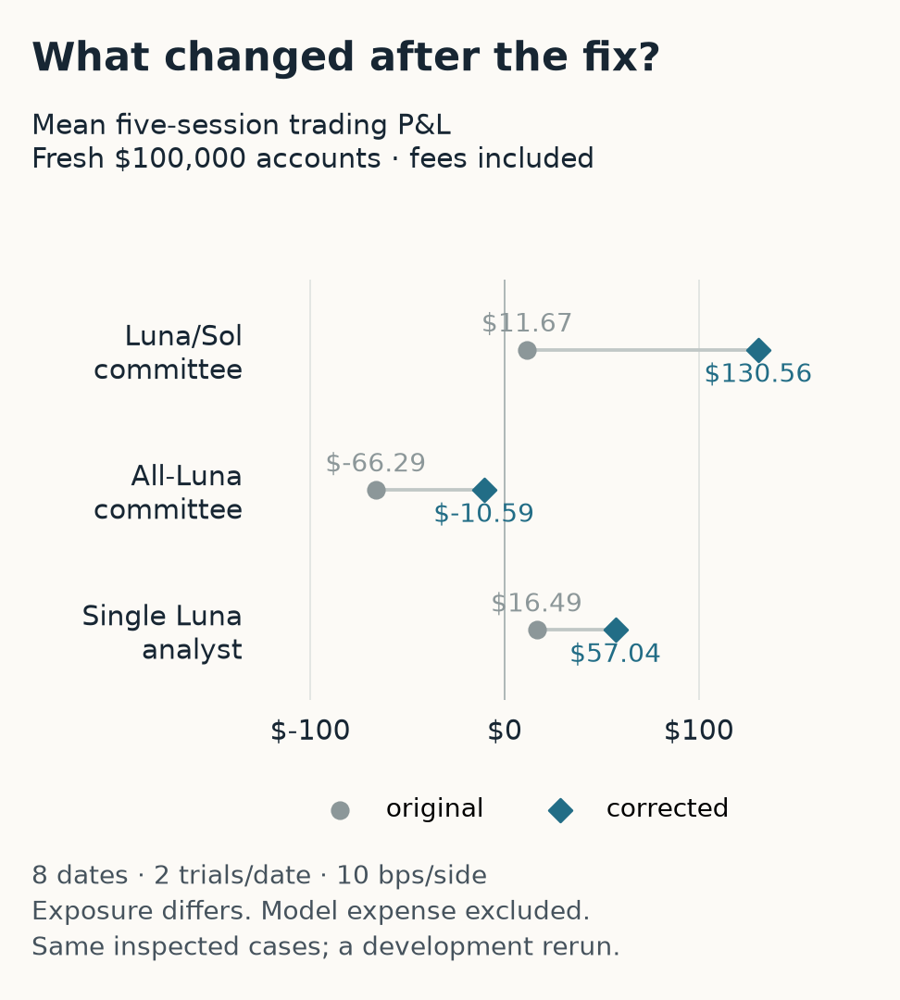

*Original vs. typed-contract mean trading P&L across the eight matured development dates ([CSV](assets/corrected-portfolio-pnl.csv)).*

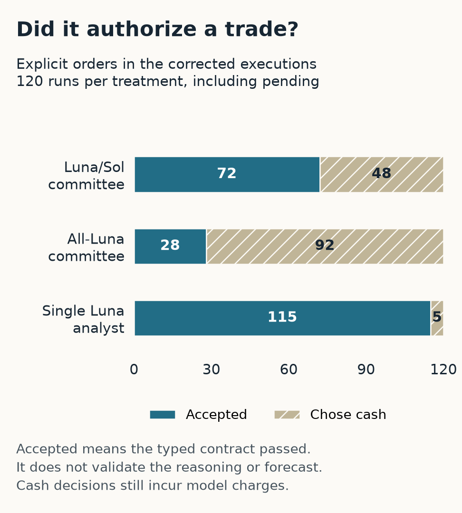

*Order outcomes across 120 executions per treatment.*

The default committee's mean invested exposure dropped from **45.0% to 20.3%**, lifting directional accuracy on its smaller active set from `36.4%` (`77` calls) to `58.3%` (`48` calls) and raising mean account P&L by `+$118.90` to **`$130.56`** (`95%` block interval `−$439.67` to `+$677.46`). On our original worst UNH case, trial 0 now sized an unconditional `25%` Underweight (`$4,162.50` stock principal plus `$4.16` entry fee—catching one prose nit in [automated review](https://github.com/ash0ts/TradingAgents/blob/forge-showcase-v1/studies/execution-contract-v2/reviews.json) where `29/30` outputs matched cleanly and one single-analyst sentence called `$4,167` “before entry fees”).

More revealing was all-Luna: **92 of its 120 runs abstained in cash**, repeatedly writing that it lacked SPY price history to prove a relative edge. Opening the tool bindings confirmed it was telling the truth—the committee price tool only queried the target stock ticker, whereas the single analyst saw SPY inline!

> **Interactive Forge Workspace view:** [Open the corrected-execution panels in CoreWeave Forge](https://forge.coreweave.com/wandb/wandb/tradingagents-election-lab?nw=zvy3sfqxpnd).

## Give everyone the same facts, then ask for receipts

To eliminate that information asymmetry (`common-evidence-v3-repaired`), we gave every role the exact same compact numerical brief—5-, 20-, and 60-session stock and SPY returns, excess returns, realized volatility, vintage-dated SEC facts with filing age, and FRED series—and locked tools to that brief. We compared two arms across `360` runs (`60 cases × 3 systems × 2 arms × 1 trial`, after halting a `40`-run pilot when our own prompt mistakenly asked the model to paste a brief SHA-256 into the `missing_sources` list on MSFT): **Shared brief** versus **Required citations**, where every cited `fact_id`, value, unit, and date is verified before a trade can clear ([protocol and records](https://github.com/ash0ts/TradingAgents/tree/forge-showcase-v1/studies/common-evidence-v3-repaired)).

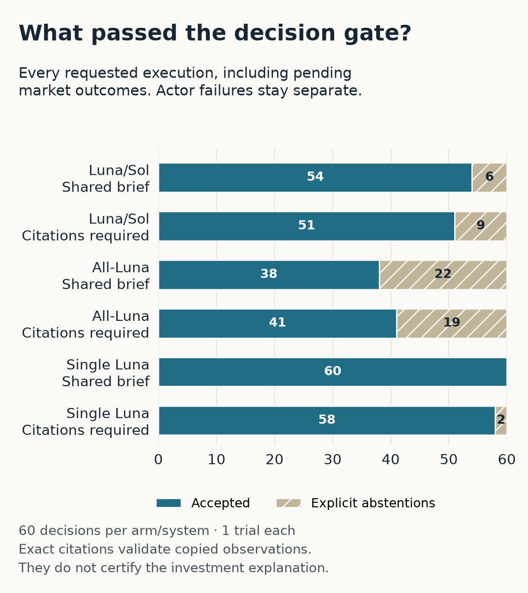

*`302` accepted contracts and `58` explicit cash abstentions; all `180` citation checks passed across `1,737` cited observations ([CSV](assets/evidence-comparison.csv)).*

Every citation resolved. The stock picks got worse:

| System and evidence | Mean trading P&L | Same-weight SPY | Selection P&L vs. SPY | Invested fraction |
|---|---:|---:|---:|---:|
| Luna/Sol · shared brief | $109.05 | $162.99 | −$53.94 | 34.3% |
| Luna/Sol · required citations | −$49.51 | $126.86 | −$176.37 | 33.8% |
| All-Luna · shared brief | $61.31 | $118.61 | −$57.31 | 27.1% |
| All-Luna · required citations | −$217.81 | $27.95 | −$245.76 | 24.5% |
| Single Luna · shared brief | $212.48 | $140.28 | +$72.20 | 43.2% |
| Single Luna · required citations | $169.98 | $153.92 | +$16.07 | 42.1% |

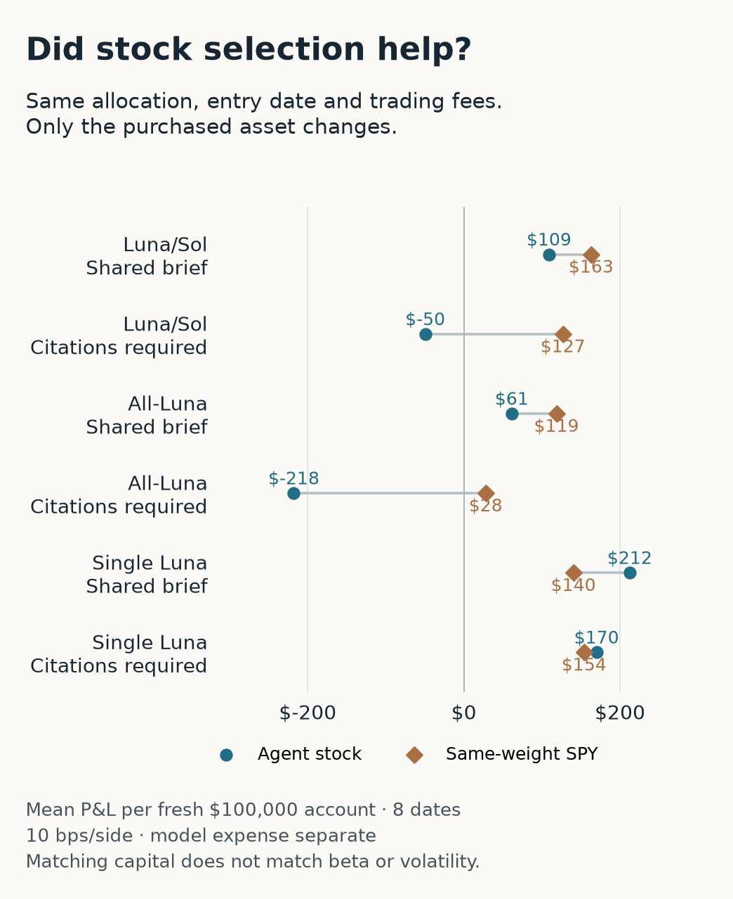

*Agent mean trading P&L connected to its matched-exposure SPY control across the eight historical dates.*

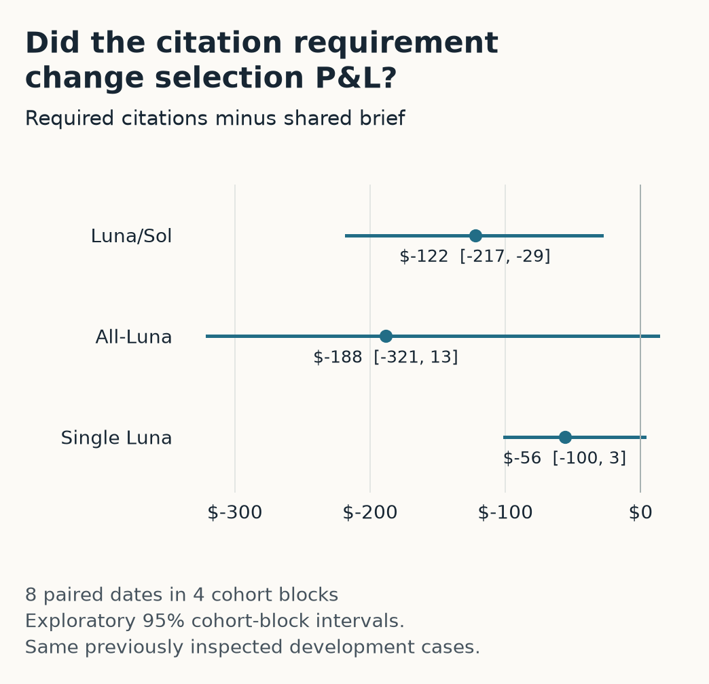

*Requiring citations shifted Luna/Sol selection P&L by `−$122.43` (`−$217.42` to `−$28.84`), all-Luna by `−$188.45`, and single Luna by `−$56.13`.*

Verifying that a number appears in a filing does not make a five-day forecast out of it—and even in `36` audited reports ([`reviews.json`](https://github.com/ash0ts/TradingAgents/blob/forge-showcase-v1/studies/common-evidence-v3-repaired/reviews.json)), `35` were clean while one shared-brief UNH summary grouped six-month operating cash flow under a “quarterly” lead-in. Still, the structured receipt in Agent Lens made every dollar auditable from cited input to fee split.

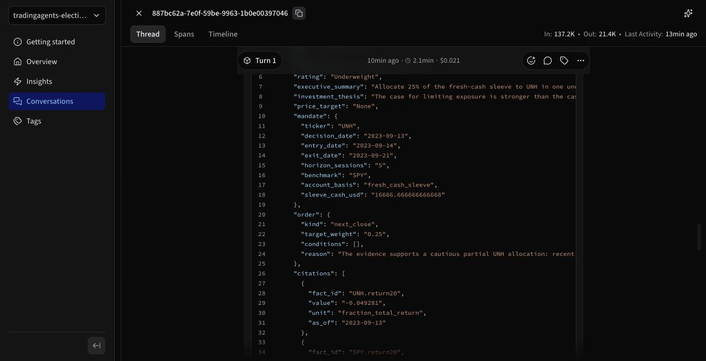

*Agent Lens turn output on UNH (September 13, 2023, all-Luna required-citations arm) showing the typed order alongside verified citations.*

> **Interactive Forge Workspace view:** [Open the matched-evidence panels in CoreWeave Forge](https://forge.coreweave.com/wandb/wandb/tradingagents-election-lab?nw=94cw9owsbt4).

## Fix the trader's dictionary—and journal spans before upload

Before testing whether debate itself helped, we had two remaining bugs of our own to clean up:

1. **Conflicting role dictionaries (`trader-handoff-v4`):** The inherited Trader prompt stated *“Overweight is a Buy and Underweight is a Sell,”* while our Portfolio Manager and simulator mapped Underweight to `25%` and Sell to `0%`. Giving the Trader the same five-rating typed schema resolved all **eight UNH engineering regressions** (`378` spans, `124` model calls in [`studies/trader-handoff-v4`](https://github.com/ash0ts/TradingAgents/tree/forge-showcase-v1/studies/trader-handoff-v4)).
2. **Silent span drops on HTTP timeouts:** During `common-evidence-v3-repaired`, one OTLP export timeout dropped a Bull Researcher subagent span on AAPL, leaving `359/360` complete hosted traces (`11,822` spans and `3,910` of `3,911` local model calls). Rather than rerunning the model to make the dashboard look tidy, we kept `359/360` on the board and added a local write-ahead span journal—verified against an injected HTTP `503` collector where `force_flush()` returned true on zero stored spans and journal replay restored every span ID and tool payload with zero model calls ([`trace-recovery-probe.json`](https://github.com/ash0ts/TradingAgents/blob/forge-showcase-v1/studies/debate-ablation-v5/trace-recovery-probe.json)).

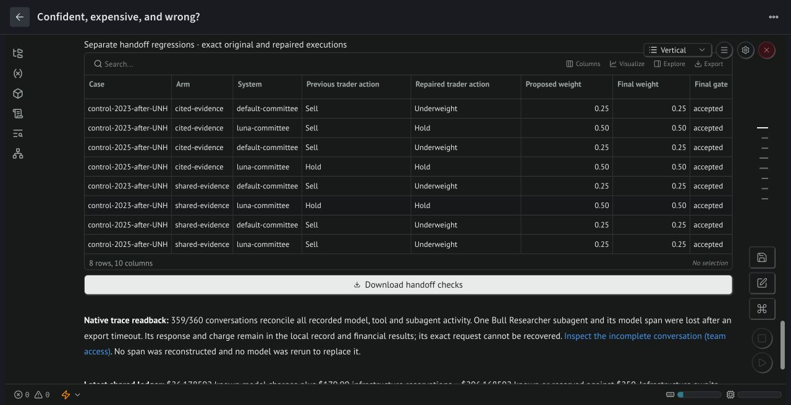

*Forge Notebook readback verifying all eight repaired Trader → Portfolio Manager handoffs.*

## Give each meeting a chance to earn its place

With the contract, shared brief, trader schema, and span journal in place, we ran the `720`-attempt ablation ([`studies/debate-ablation-v5`](https://github.com/ash0ts/TradingAgents/tree/forge-showcase-v1/studies/debate-ablation-v5)): all roles on `gpt-6-luna`, three fresh trials per case across all `60` cases (`180` attempts per workflow), comparing the **Full committee**, **No research debate** (analyst reports straight to Research Manager), **No risk debate** (research + trader plans straight to Portfolio Manager), and **Single analyst**. Prior literature—from [Smit et al. on multi-agent debate sensitivity](https://arxiv.org/abs/2311.17371v3) to [controlled proposal/verification studies](https://arxiv.org/abs/2610.04686v1)—suggests extra rounds help only when they change verification rather than adding chatter.

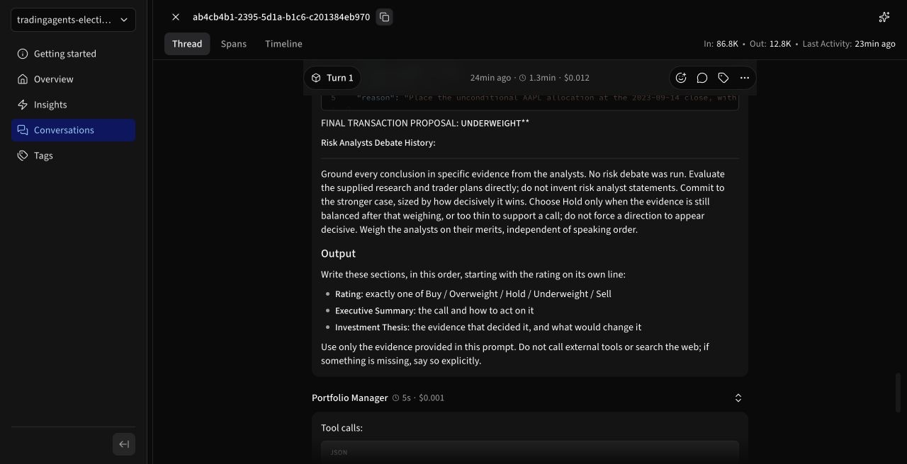

*Agent Lens span verification on AAPL (`no-risk` arm, trial 0): hosted readback confirms the omitted risk subagents never ran and the Portfolio Manager received the explicit no-risk prompt.*

All **720 conversations** (`24,818` spans, `7,804` model calls) reconciled end to end: `651` accepted contracts, `65` explicit cash abstentions, and `4` unretried provider HTTP `520` errors held in cash. Across the **eight historical dates** frozen November 5:

| Workflow | Mean trading P&L | Mean selection P&L vs. matched SPY | Model-cost upper bound (180 attempts) |
|---|---:|---:|---:|
| Full committee | $105.66 | +$32.42 | $3.379940 |
| No research debate | $183.73 | +$38.64 | $2.751820 |
| No risk debate | $65.52 | −$33.10 | $2.421843 |
| Single analyst | $98.01 | −$83.95 | $0.139322 |

*Eight historical dates, three trials per date, 10 bps per side ([exact summaries](assets/debate-summaries.csv)).*

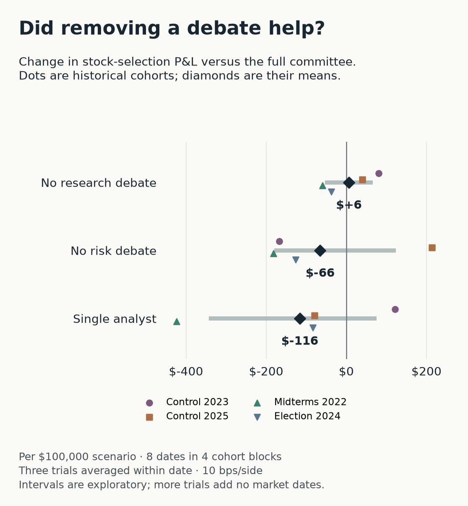

*Planned selection-P&L contrasts vs. full committee ([date-level contrasts](assets/debate-contrasts.csv)): dropping research debate changed selection P&L by `+$6.22` (`−$48.32` to `+$60.77`), dropping risk debate by `−$65.51`, and dropping to one analyst by `−$116.37` (which shrinks to `−$13.96` if 2022 is excluded; exact four-block sign-flip `p ≥ 0.125`, Holm-adjusted `1.0`).*

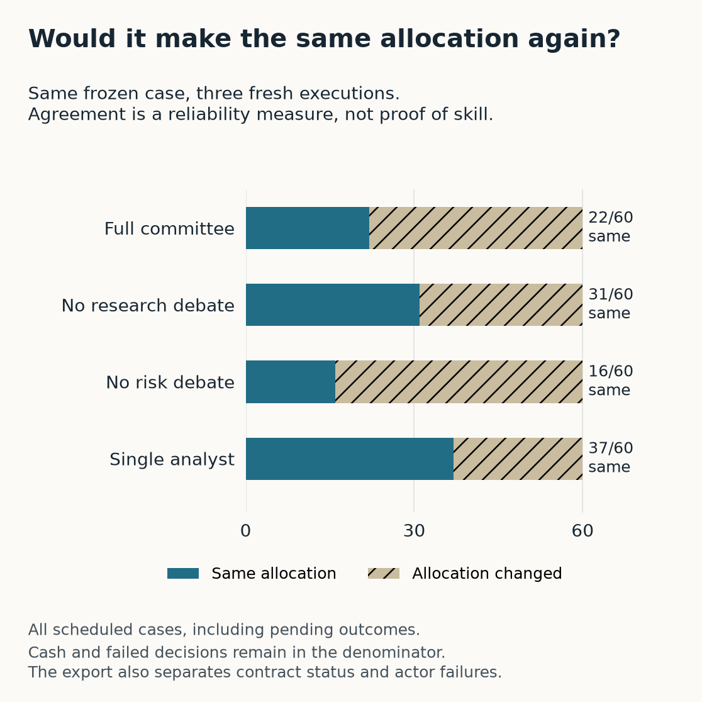

*Three-run exact allocation agreement across all 60 cases: `22/60` full committee, `31/60` no research debate, `16/60` no risk debate, and `37/60` single analyst.*

Notice the trap if we had graded consistency alone: the single analyst was the most repeatable (`37/60`) and posted the worst historical selection P&L (`−$83.95`), plus an arithmetic slip caught in our `40`-case prespecified review ([`regressions.json`](https://github.com/ash0ts/TradingAgents/blob/forge-showcase-v1/studies/debate-ablation-v5/regressions.json)) where it claimed `0.1084` percentage points was smaller than a `10`-bps (`0.10` pp) one-way fee. Meanwhile, skipping the bull/bear research debate cut mean latency from **119s to 85s** and 180-run cost from **`$3.38` to `$2.75`** while tracking within `$6.22` of the full committee.

> **Interactive Forge Workspace view:** [Open the repeated-ablation panels in CoreWeave Forge](https://forge.coreweave.com/wandb/wandb/tradingagents-election-lab?nw=tmuo3ynvgek).

### What happened when the November 2026 midterms matured

Every 2026 midterm prediction across those campaigns was sealed, SHA-256 hashed, and exported to Agent Lens on or before November 10—before the five-session exit closes on **November 10** (`before` cohort, entered November 3) and **November 12** (`after` cohort, entered November 5) existed in market data. On November 16, we left `lab-data/election-v1/outcomes.json` untouched so historical hashes stay reproducible, pulled the settled closes through November 13 (`SPY −0.59%` before, `+3.29%` after; `NVDA −18.29%` before, `−8.49%` after), and scored all **144 sealed forward decisions** in [`midterms-2026-matured-20261116.json`](https://github.com/ash0ts/TradingAgents/blob/forge-showcase-v1/articles/evidence/midterms-2026-matured-20261116.json) alongside four six-cohort [Forge EvalTables](https://forge.coreweave.com/wandb/wandb/tradingagents-election-lab):

| Workflow (36 sealed forward decisions, 6 scenarios each) | Actionable calls | Forward directional accuracy | Mean signed excess return | Mean trading P&L ($100k, 10 bps) | Forward selection P&L vs. matched SPY |
|---|---:|---:|---:|---:|---:|
| Full committee | 16 / 36 | 62.5% | +4.46% | −$174.22 | −$653.87 |
| No research debate | 10 / 36 | 70.0% | +6.35% | −$550.23 | −$1,055.92 |
| No risk debate | 12 / 36 | 58.3% | +3.47% | −$108.53 | −$502.50 |
| Single analyst | 16 / 36 | 31.3% | +2.00% | −$94.59 | −$787.59 |

*Out-of-sample November 2026 midterm results (`2` dates × `6` stocks × `3` trials per workflow). For context, 100%-invested SPY averaged `+$1,149.16` across the two dates (`−$785.89` before, `+$3,084.21` after), while the equal-weight six-stock basket lost `−$1,687.22` due to `NVDA` and `XOM` drawdowns.*

That forward window reinforces both halves of our conclusion without hindsight tuning. On directional calls where a workflow took an active view, all three committee variants outperformed the single analyst (`58.3%`–`70.0%` vs. `31.3%`), with **No research debate** again matching or beating the full committee on directional accuracy while abstaining slightly more often. Yet in dollar portfolio terms, **every workflow still lagged matched-exposure SPY** (`−$502.50` to `−$1,055.92`): holding neutral `50%` sleeves or partial tech exposure during an `18%` `NVDA` drop swamped correct Underweight calls on quieter names.

## Open the evidence, then decide what to change

All public predictions, unit-account factors (reproducing every matured account scenario with Python's standard library and zero licensed raw quotes), protocols, and audited regressions live on [`forge-showcase-v1`](https://github.com/ash0ts/TradingAgents/tree/forge-showcase-v1) (and in the [CoreWeave Forge & Agent Lens examples hub](https://github.com/ash0ts/forge-agent-lens-examples)): the [initial 960-prediction evidence zip](https://github.com/ash0ts/TradingAgents/blob/forge-showcase-v1/articles/evidence/tradingagents-public-evidence.zip), the [1,120-account scenario stress test](https://github.com/ash0ts/TradingAgents/blob/forge-showcase-v1/articles/trading-scenarios/README.md), the [internals audit](https://github.com/ash0ts/TradingAgents/blob/forge-showcase-v1/articles/internals/README.md), [`common-evidence-v3-repaired`](https://github.com/ash0ts/TradingAgents/tree/forge-showcase-v1/studies/common-evidence-v3-repaired), [`debate-ablation-v5`](https://github.com/ash0ts/TradingAgents/tree/forge-showcase-v1/studies/debate-ablation-v5), and the three saved Forge Notebooks ([meet the committee](https://forge.coreweave.com/notebooks/Tm90ZWJvb2s6MTUyNjA%3D), [investigate behavior](https://forge.coreweave.com/notebooks/Tm90ZWJvb2s6MTUyNzE%3D), and [compare financial outcomes](https://forge.coreweave.com/notebooks/Tm90ZWJvb2s6MTUyNzI%3D)).

Our own cost ledger caught one last measurement bug before closeout ([accounting amendment](https://github.com/ash0ts/TradingAgents/blob/forge-showcase-v1/studies/debate-ablation-v5/analysis-amendment.json)): prompt cache writes had been priced at base input rates rather than the cache-write premium, adding **`$4.535997`** across the full study history (`$8.640683` known + `$0.052242` reserved in the 720-run ablation, and **`$38.527203`** known model spend across every iteration, well inside our `$250` total study cap). Because the frozen OTLP span attributes didn't carry a separate cache-write token field, keeping an independent SQLite budget ledger alongside Agent Lens paid for itself.

I would keep the typed execution contract, the symmetric evidence brief, the write-ahead span journal, and the trace-to-dollar checks in Forge—and drop the bull/bear research debate in favor of testing the leaner risk-checked committee against Ridge and mean-reversion baselines on a larger universe with timestamped news archives. Agent Lens turned a confusing `$1,153.72` loss into four specific, fixable bugs in our own harness. Turning an opinionated committee into something worth your money still takes more market dates than a single election week can supply.
