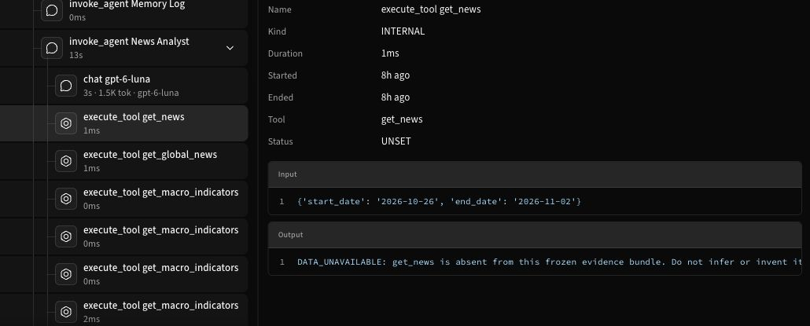
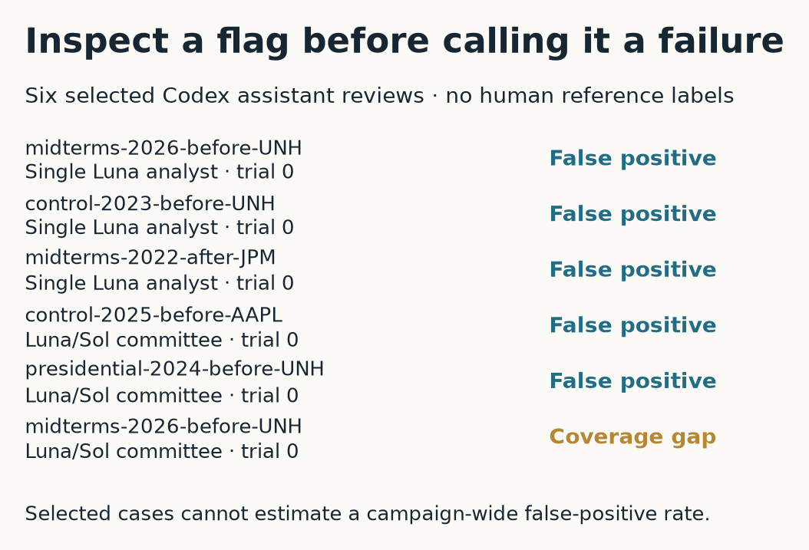
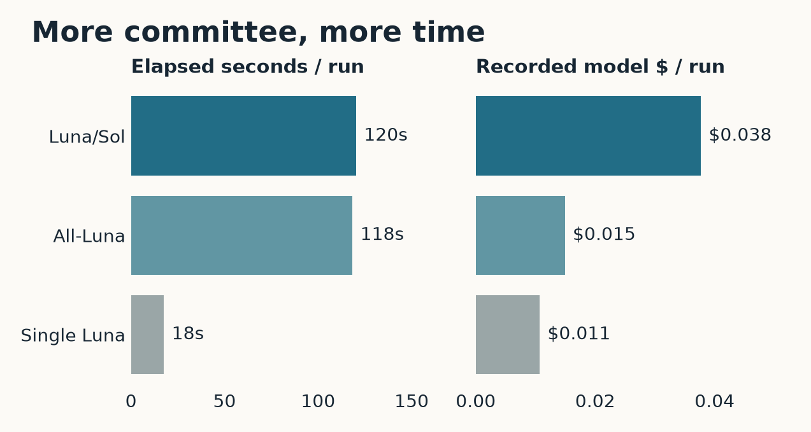
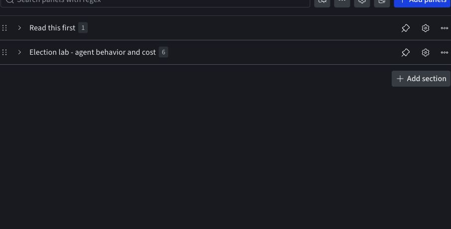

# Confident, expensive, and wrong?

The news tool returned `DATA_UNAVAILABLE`. The TradingAgents run completed successfully.

Both statements describe the same UNH case immediately before the November 2026 midterms. The default committee could finish its workflow even though its frozen evidence bundle contained no archived news. An exception counter would miss that distinction. A financial score could not settle it either: the case’s five-session outcome was still pending at the November 5 freeze. We could inspect the evidence gap immediately, before learning whether the recommendation made money. The case and its review are preserved in [the Forge investigation notebook](https://forge.coreweave.com/notebooks/Tm90ZWJvb2s6MTUyNzE%3D).

*Actual Agent Lens span details, November 6 capture. The request dates and missing-data response are visible; raw trace identifiers and unrelated source bodies are excluded. A successful tool invocation can return unavailable evidence.*

This is where I want to spend time in an agent demo. The final recommendation tells us what the system chose. Its execution history lets us examine the material it encountered on the way there. For this study, Agent Lens connects the research request, individual committee roles, model calls, tool results, and completed decision. The reports are visible outputs generated during the run. They show the explanations the agents produced. They don’t expose an unrecorded internal thought process or prove which sentence caused a decision.

In the UNH conversation, the immediate finding is limited and concrete. The news tool had no archived source to return. Replay preserved that gap instead of filling it with current news. The reviewed regression case records an evidence-coverage failure. It does not accuse the model of inventing an article. Those two diagnoses call for different responses: obtaining a usable archive would change the evidence; changing the recommendation prompt would change how the system handles missing evidence. A trace helps identify which intervention is worth testing.

Our deterministic checks made that distinction especially necessary. Across 360 completed agent runs, they produced the following candidate tags. A run can receive more than one tag, so the counts are not a partition of the campaign.

| Check | Flagged runs | What still needs inspection |
|---|---:|---|
| Missing tool evidence | 240 | Whether the recommendation acknowledges the gap |
| Missing-data acknowledgment candidate | 5 | Whether the checker missed a valid acknowledgment |
| Unavailable evidence presented as fact | 2 | Whether the report makes a claim or describes a condition |
| Repeated tool call | 1 | Whether repetition was unnecessary |
| Unsupported current price | 1 | Whether the number has supporting evidence |

The 240 missing-evidence flags cover the committee runs, whose tools encounter the unavailable sources. They are not 240 confirmed hallucinations. The single analyst receives its evidence bundle directly, so this tool-based check also measures a difference in workflow. Comparing raw tag counts across those systems without inspecting what generated them would penalize the committees partly for having tools to call.

Six selected findings received a Codex assistant review. The records explicitly identify the reviewer as an assistant, not a human domain expert. Five findings were classified as false positives. One confirmed the UNH news-coverage gap. Because these were selected examples, six reviews do not support an estimate of the checker’s overall false-positive rate. They do support reopening the candidate labels before turning them into a public failure leaderboard.

*These are the six selected Codex assistant reviews, not a human-labeled benchmark. Read each [review rationale and evidence digest](../evidence/assistant-reviews.csv) before interpreting its label.*

One false positive came from the single analyst’s UNH report in the 2023 control cohort. The review found an explicit statement that the evidence lacked news and social sources; the lexical check had missed the word “lacks.” Another candidate involved the default committee’s AAPL report in the 2025 control cohort. The review found a conditional discussion of incomplete evidence and an unconfirmed breakout, rather than a claim that news had established the breakout. A checker looking for a few suspicious phrases can lose the condition that makes the sentence accurate.

These examples give the evaluation code a fairly embarrassing job: learn to recognize the acknowledgment it asked the agent to provide. They also explain why we did not switch on an LLM judge and treat its labels as settled. Anthropic’s [guide to agent evaluations](https://www.anthropic.com/research/demystifying-evals-for-ai-agents) distinguishes code, model, and human graders, including the brittleness of string matching and the need to calibrate model judgments against expert review. Our six assistant reviews are a starting point for that work. They do not supply the human reference set needed to claim a calibrated judge.

Agent Lens is the main interface for reading these cases. The campaign views narrow the records by treatment, errors, and reviewed cases. From a conversation, the span tree identifies the analyst and tool involved; the timeline helps locate repeated work or expensive stages. The readable conversation preserves the initial request and final recommendation so that the investigation does not begin with a wall of telemetry. An empty error view still requires care: a tool can successfully return a missing-data response, as it did here.

We keep intermediate recommendations visible for the same reason. A trader and portfolio manager can disagree because later discussion changes the decision. That difference is worth examining, but it is not sufficient evidence of a contradiction. The reviewer needs the timing, the evidence available at each stage, and the scope of the recommendation. Marking every change of mind as a failure would make debate difficult to evaluate on its own terms.

For the implementation, the most consequential choice was the identity of a run. One conversation represents one case, treatment, trial, and attempt. Resuming an interrupted attempt keeps that conversation ID; starting another trial gets a separate identity. Analyst context must propagate across parallel execution, and child spans need their actual parents. Otherwise, a plausible-looking report can be attached to the wrong trial, which is a much harder problem to spot than a missing chart.

We use native Forge instrumentation through `coreweave.forge.agentlens.tracing`. The tracing adapter records the model provider, model name, actual messages, usage, timing, errors, and tool arguments and results. Span closure and flushing happen on error paths as well as successful exits. Historical market dates are attributes, while execution timestamps retain the real time of the run. The integration follows the documented [Agent Lens hierarchy](https://docs.coreweave.com/products/agent-lens/tracing/instrument), with subagents identifying the committee roles.

Weave provides the evaluation persistence layer through a separate adapter. Its prediction context opens before the agent executes, so the corresponding evaluation Call IDs already exist when native spans are created. We attach `weave.eval.run_id` and `weave.eval.predict_and_score_call_id` to each linked span. These are evaluation Call IDs; substituting a trace ID would not establish the link. The [documented evaluation bridge](https://docs.coreweave.com/products/wandb/weave/guides/evaluation/evaluation_logger) explains both attributes and the need to propagate them to every relevant span.

That arrangement also requires choosing who records a model call. Native tracing owns that activity here; implicit legacy instrumentation is disabled. Otherwise, two systems can each count the same request and produce misleading usage totals. Hosted readback verified all 360 conversations, all 15,058 spans, and the campaign’s 4,149 model calls. Parent relationships, evaluation links, and token usage reconciled with the local records. This verifies that the measured executions can be followed and accounted for; semantic correctness still depends on inspecting their contents.

The “expensive” part of the title needs units. The default committee averaged about 120 seconds and $0.038 in recorded model charges per run. The all-Luna committee averaged 118 seconds and $0.015; the single analyst averaged 18 seconds and $0.011. These are campaign averages, with infrastructure and local hardware costs excluded. The committee consumed substantially more elapsed time, while its API charge remained small. This experiment did not establish that additional deliberation improved financial outcomes.

*120 executions per treatment; model charges exclude infrastructure and local hardware. Prompt and evidence-delivery differences prevent a causal estimate of debate overhead.*

*The same operational comparison in the [native behavior dashboard](https://forge.coreweave.com/wandb/wandb/tradingagents-election-lab?nw=oc6zwblxo0y). The underlying saved view filters to the 13 method-summary runs; these two panels report the three agents. Screenshot captured November 6.*

The investigation notebook includes the strongest result, the weakest result, and an example selected with a fixed random seed. That gives readers a way to inspect success and ordinary behavior alongside failure candidates. The public notebook contains sanitized results and review explanations. Agent Lens drilldowns and raw source evidence require team access; public availability of a summary does not imply public access to the underlying reports.

The confirmed UNH case is exported into a versioned regression dataset. Its expected behavior is precise: preserve the missing-news response, expose the evidence gap, and never substitute live news during replay. Once a case informs a change, it belongs in development or regression work. It cannot later be advertised as an untouched test of the same change.

I would next ask a domain expert to review a small set of flagged examples, paired with unflagged examples from the same treatments. That would tell us whether to improve the checker, the evidence collection, or the agent’s handling of missing information. Until then, the notebook retains the candidates and their review provenance. The [financial comparison](../did-it-beat-doing-nothing/article.md) can proceed separately, with no need to turn a losing trade into a hallucination or a profitable trade into proof of sound reasoning.

The [public evidence package](../evidence/tradingagents-public-evidence.zip) includes all 960 predictions, 2,880 horizon scores, 640 portfolio scenarios, source coverage, paired comparisons, selected reviews, and a hash manifest. Its [reproduction guide](../evidence/README.md) explains the joins and units. Raw licensed source material and Agent Lens drilldowns remain authenticated; the public tables support checking the reported results without exposing those sources.
