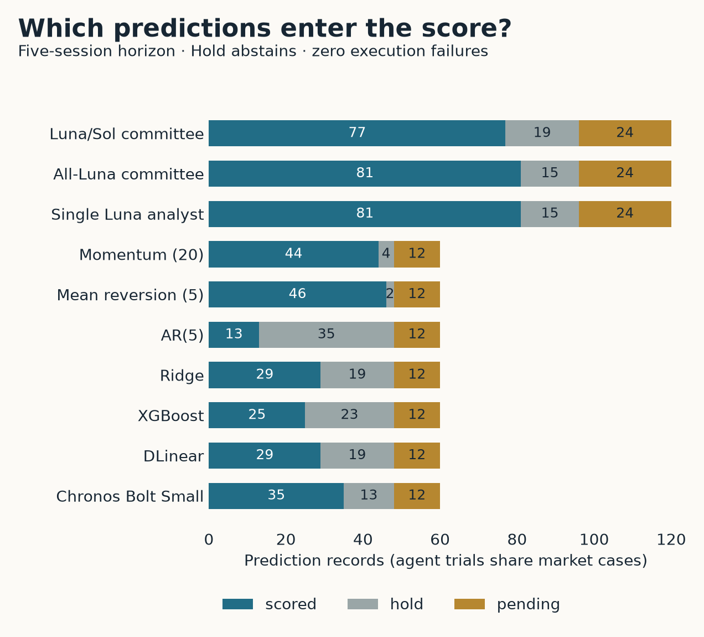
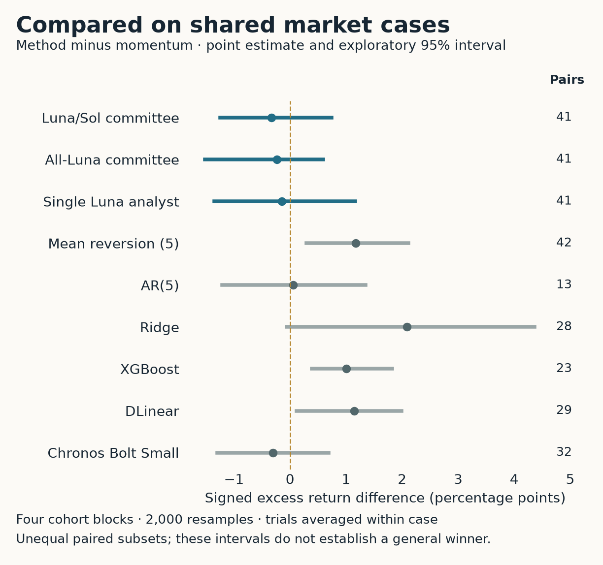
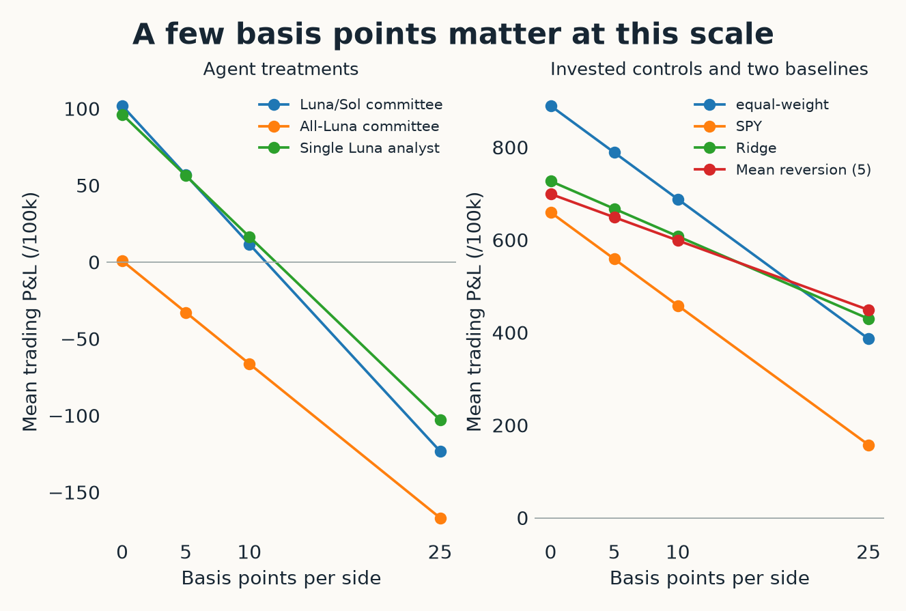
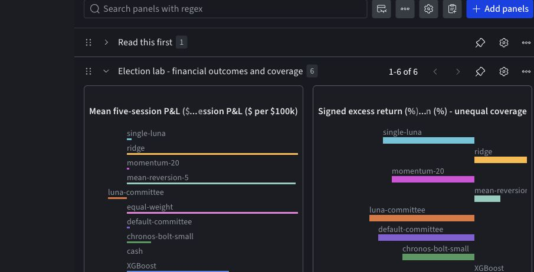

# Did it beat doing nothing?

Our AI investment committees didn’t make a strong case for managing the money. On the eight decision dates with completed five-session outcomes, the default Luna/Sol committee averaged $11.67 in trading profit per independent $100,000 scenario. The all-Luna committee averaged a $66.29 loss. A single Luna analyst averaged a $16.49 profit. Buying the SPY benchmark fund averaged $458.44, and buying an equal-weight basket of the six study stocks averaged $688.05. Those figures include trading fees and exclude model expense. The [Forge comparison notebook](https://forge.coreweave.com/notebooks/Tm90ZWJvb2s6MTUyNzI%3D) contains every method, pending outcome, and scenario.

Doing nothing needs a definition here. Cash earns zero in our simulator because we do not accrue interest. Buying SPY and waiting is another passive choice; buying the six-stock basket is a third. A committee can beat idle cash by a few dollars and still trail both invested controls. The answer also depends on how much money the committee puts at risk. The default committee averaged roughly 45% invested exposure at entry, compared with almost 100% for SPY. The figure compares realized P&L under the stated allocations, without adjusting the methods to equal exposure.

*Eight matured decision dates; two trials per agent/date, one result per other method/date. Fees are 10 basis points per side. Model expense is separate. These are descriptive means of independent scenarios, not a compounded account or a significance ranking. [Exact figure data](assets/portfolio-pnl.csv).*

The experiment contains 60 stock/date cases: AAPL, MSFT, NVDA, JPM, XOM, and UNH on the sessions immediately before and after five anchors. Three anchors are the 2022, 2024, and 2026 elections; two are September calendar controls in 2023 and 2025. Each of the three agent treatments ran twice per case. Ten numerical or passive methods supplied another 600 prediction records. All completed. At the November 5, 2026 freeze, the current election’s five-session outcomes were still pending, leaving four matured cohorts and eight decision dates for the opening comparison.

We wanted alternatives with different reasons to succeed. Twenty-session momentum extrapolates recent stock performance relative to SPY. Five-session mean reversion predicts a reversal of the recent relative move. AR(5) fits a linear relationship between daily relative returns and their five preceding values. Ridge regression predicts the delayed five-session excess return from 20 daily lags, with regularization. XGBoost uses those same lag features with boosted trees, allowing nonlinear relationships. These methods make the comparison more informative than asking whether one committee beats another committee.

The neural entries cover two different training situations. Our locally trained DLinear adaptation separates a moving-average component from a residual and fits a linear map to each. Zeng and colleagues’ [LTSF-Linear research](https://arxiv.org/abs/2205.13504v3) motivated including simple learned forecasting models beside more elaborate systems. Their long-horizon benchmark is different from this stock-return task; our small implementation is an adaptation, not a replication of their reported results. We also run the pinned, 48-million-parameter [Amazon Chronos Bolt Small](https://huggingface.co/amazon/chronos-bolt-small), a pretrained forecasting model, locally. It receives 512 observations for the stock and benchmark series and forecasts the entry and exit levels used for the relative-return prediction. Its exposure to historical information during pretraining is unknown.

The forecasting target must respect execution time. Information stops at the decision day’s end, entry occurs at the following trading session’s close, and liquidation occurs five sessions after entry. An autoregressive forecast therefore needs six future steps and excludes the first step’s return. Training a model to predict the next five returns and calling that the trading target would give it a different job. Dividends and splits also need to be accounted for consistently; otherwise, an apparent price move can reflect a corporate action rather than the return an investor received.

For supervised models, labels must finish before the cohort’s first decision date. We use chronological validation, retain the final 20% of eligible examples for validation, and purge six examples at the boundary to separate overlapping labels. Scaling is fitted on the training portion. Hyperparameters are fixed before the evaluation cohort rather than selected for the best result in the published table. These choices control leakage through the fitted models. They do not erase pretrained knowledge from Chronos or the LLMs, and they cannot prevent a researcher from overfitting a subsequent experiment to results already inspected.

The agents also have different information and instructions. Numerical methods receive prices and corporate actions. Agents can use SEC and macro evidence as well, although archived news and social data are absent. The single analyst gets a compact bundle directly; the committees retrieve evidence through tools. More seriously for a debate comparison, the committees retain the repository’s recommendation prompts, while the single analyst is explicitly asked about five-session performance relative to SPY. Model choice, prompt objective, and evidence delivery all change across treatments. A performance difference here cannot be attributed to the number of agents alone.

Before converting recommendations into a portfolio, we score whether they predict outperformance or underperformance of SPY. Buy and Overweight count as positive directions; Underweight and Sell count as negative directions. Hold abstains from this directional metric. Signed excess return multiplies that direction by the realized stock-minus-SPY return. A correct Underweight can receive a positive score even if the stock rose, provided SPY rose more. This score measures the directional call; the portfolio calculation below determines what happens to dollars.

| Method | Directional accuracy | Scored predictions | Mean signed excess return |
|---|---:|---:|---:|
| Default Luna/Sol committee | 36.4% | 77 | −1.30% |
| All-Luna committee | 28.4% | 81 | −1.42% |
| Single Luna analyst | 29.6% | 81 | −1.24% |
| 20-session momentum | 34.1% | 44 | −1.11% |
| Five-session mean reversion | 67.4% | 46 | +0.34% |
| AR(5) | 30.8% | 13 | −1.85% |
| Ridge regression | 58.6% | 29 | +1.01% |
| XGBoost | 52.0% | 25 | +0.21% |
| Locally trained DLinear | 58.6% | 29 | +0.21% |
| Chronos Bolt Small | 48.6% | 35 | −0.97% |

*Only successful, non-abstaining predictions with matured five-session outcomes are scored. Each agent requested 120 predictions, including 24 with pending outcomes; each numerical method requested 60, including 12 pending. The scored predictions overlap differently across methods. Agent counts include repeated trials on the same case. Passive controls make no directional forecast and therefore have no directional accuracy.*

Mean reversion’s 67.4% accuracy is an appealing result. Ridge’s larger mean signed excess return, despite lower accuracy, shows why counting correct calls is insufficient: the size of the relative moves also matters. AR(5), meanwhile, has only 13 scored predictions. Its other cases include many Holds, so its accuracy describes a much narrower selection. The notebook retains coverage and abstentions alongside scores; numerical forecast errors are available only for methods that produce numerical forecasts.

*Pending is classified first, so the groups do not overlap. Agent records include two trials per market case; numerical methods have one. Passive methods make no directional forecasts. [Exact denominators](../evidence/directional-denominators.csv).*

To compare methods on common observations, we average repeated trials within each stock/date case and then calculate paired differences. Default committee minus momentum is −0.33 percentage points of signed excess return across 41 matched cases. Its exploratory 95% cohort-block bootstrap interval runs from −1.25 to +0.74 percentage points. We resample cohorts because stocks and nearby decisions share market conditions. With only four matured cohort blocks, this is a rough uncertainty check. It does not establish an advantage from debate, an election effect, or reliable population-level precision.

*Trials are averaged within each market case before pairing. The intervals use 2,000 cohort-block resamples, seed 2026; paired subsets differ and no multiple-comparison correction is applied. [All paired estimates](../evidence/paired-comparisons.csv).*

Inspecting a roster and choosing its best row creates another problem. Bailey and colleagues’ [research on backtest overfitting](https://www.davidhbailey.com/dhbpapers/backtest-prob.pdf) examines how selecting strategies through repeated historical comparisons can produce misleading winners. We have not estimated that paper’s probability-of-overfitting measure here. Its relevance is procedural: if these results influence the next model or prompt, that next model needs new evaluation data. The favorable mean-reversion result is a candidate for a later test, not permission to retune it against these dates and report the improved number as fresh evidence.

The portfolio replay makes the recommendations concrete. Each decision date starts a new $100,000 account divided into six equal stock sleeves. Buy, Overweight, Hold, Underweight, and Sell invest 100%, 75%, 50%, 25%, and 0% of the corresponding sleeve. Numerical forecasts enter those same buckets at thresholds of −1%, −0.25%, +0.25%, and +1% excess return. The strategy is long-only. Sell leaves cash; it does not open a short position. Hold abstains from the directional score while still investing half a sleeve, an easy distinction to lose when reading the table and chart together.

At the main fee setting, each side costs 10 basis points, or 0.1% of traded notional. Entry allocations include the fee so that a fully invested sleeve does not borrow money to pay for its purchase. The simulator permits fractional shares, applies corporate actions and dividends, and reconciles final cash with buys, sales, income, and fees. The notebook also shows 0-, 5-, and 25-basis-point fee settings. They are cost sensitivities, not realistic estimates of every stock’s spread or market impact at every historical close.

*Panels use separate vertical scales. Selected methods keep the plot readable; the [fee-sensitivity CSV](../evidence/fee-sensitivity.csv) contains all 13. Each point averages the same matured, independent scenarios. Model expense is excluded.*

Overlapping scenarios remain separate. Concatenating their equity curves would pretend that the same $100,000 could fund simultaneous full-sized positions without an allocation rule. Agent results average two trials on each of eight matured dates, while other methods have one result per date. Repeating the agent creates more runs to inspect, but still only eight date scenarios. We report exposure, turnover, and scenario drawdown without turning this short, overlapping study into an annualized performance claim.

Recorded model charges for qualification and the campaign total $7.68. Every model call has a known charge in the ledger. Infrastructure has a separate $175 reservation awaiting invoice reconciliation; that is a hold against the $250 cap, not recorded spending. Local training hardware is unmetered. The portfolio chart excludes model expense, and the notebook keeps it separate so that cheap inference is not mistaken for free research. The [behavior and cost dashboard](https://forge.coreweave.com/wandb/wandb/tradingagents-election-lab?nw=oc6zwblxo0y) provides the operational comparison; the [financial dashboard](https://forge.coreweave.com/wandb/wandb/tradingagents-election-lab?nw=0q277wzs5up) provides the outcome comparison.

*Two panels from the saved financial workspace, captured November 6. Portfolio P&L and signed excess return answer different questions and use different denominators. The downloadable tables preserve both.*

I would use the next budget to make the agent comparison narrower before making it larger. Give the committee and single analyst the same five-session objective and evidence presentation, retain the current methods as fixed baselines, and register a new forward window before its outcomes arrive. Human review of a small set of flagged and unflagged conversations should precede any automated behavioral judge. Meanwhile, the saved Forge results already let a reader choose a financial outcome and return to its evidence coverage, reviewed behavior, and authenticated Agent Lens conversation. That is enough to decide what to test next, while the 2026 cells wait for the market to supply their outcomes.

The [public evidence package](../evidence/tradingagents-public-evidence.zip) includes all 960 predictions, 2,880 horizon scores, 640 portfolio scenarios, source coverage, paired comparisons, selected reviews, and a hash manifest. Its [reproduction guide](../evidence/README.md) explains the joins and units. Raw licensed source material and Agent Lens drilldowns remain authenticated; the public tables support checking the reported results without exposing those sources.
