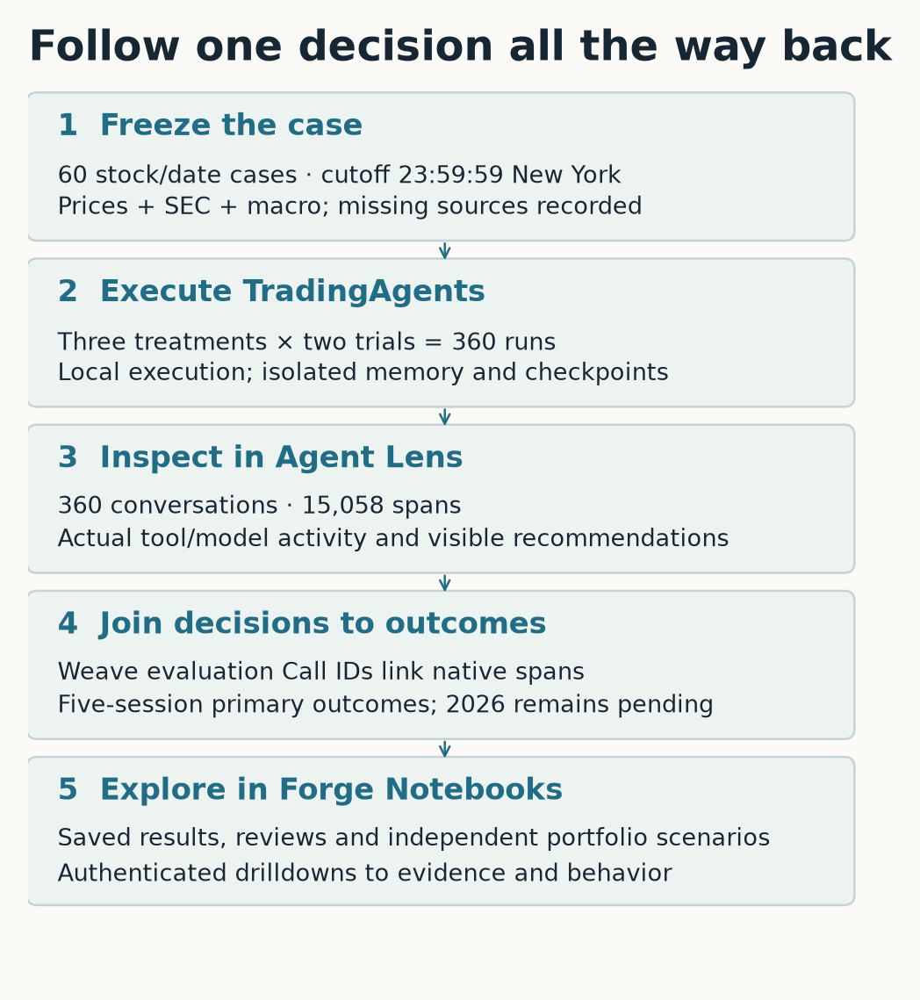
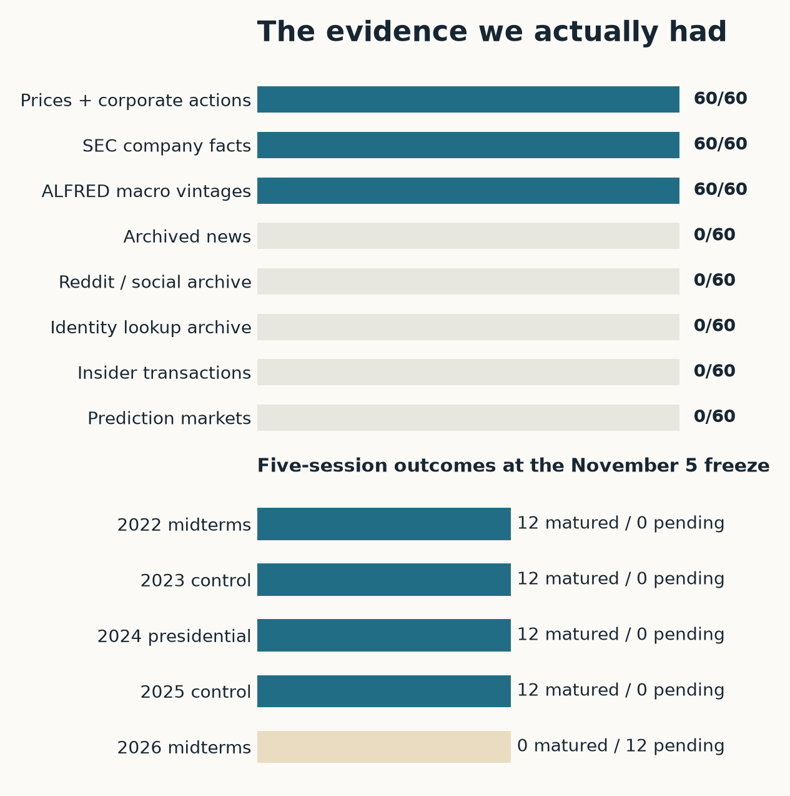
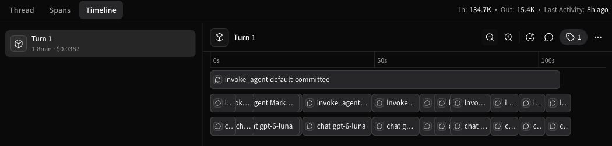
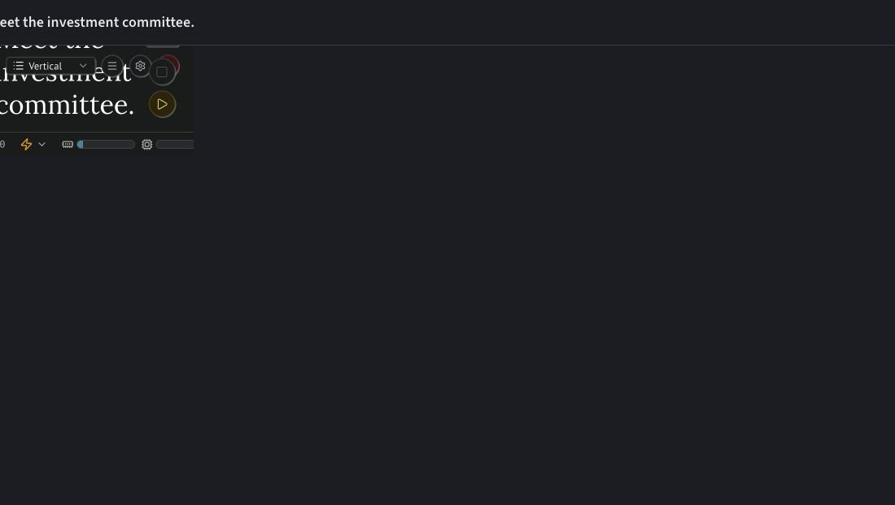

# Would you give this investment committee money?

We gave an AI investment committee a simulated $100,000 and a familiar organizational structure: analysts, opposing researchers, a trader, a risk discussion, and a portfolio manager. Across the eight decision dates with completed five-session outcomes, the default committee averaged $11.67 in trading profit after fees, before model expense. Buying the SPY benchmark fund averaged $458.44. Each date was a separate scenario; these are neither compounded returns nor an estimate of what the system will earn next week. The [saved study report](https://forge.coreweave.com/wandb/wandb/tradingagents-election-lab/reports/Would-you-give-this-investment-committee-money--VmlldzoxODI2MzIwNQ==) includes the full comparison.

The committee did produce considerably more meeting notes. A polished recommendation is easy to read as evidence of competence, especially when several named specialists appear to have challenged it. We wanted to examine the recommendation alongside the information available to those specialists, the calls they made, and the eventual outcome. Agent Lens provides the conversation and execution history. Forge holds the notebooks, comparisons, and versioned artifacts.

*The implemented route from evidence to result. The diagram describes where records live; tracing alone does not establish decision quality.*

The timing supplied the premise. With the November 2026 election as an anchor, we could ask how the same systems behaved around earlier elections and ordinary calendar dates. As of the November 5 data freeze, the 2026 five-session outcomes had not matured. They remain pending throughout the notebooks. The opening comparison comes from the older cohorts; it says nothing about whether the agents successfully traded the current election.

TradingAgents already supplies an unusually inspectable structure for this question. In Xiao and colleagues’ [TradingAgents paper](https://arxiv.org/abs/2412.20138v7), specialized analysts produce reports, bull and bear researchers debate a position, and trading and risk roles work toward a decision. Its reported backtest covers January through March 2024 and compares trading performance with several established strategies. Our fork changes the dates, models, evidence delivery, and evaluation procedure. This study therefore makes a separate measurement; it does not reproduce the paper’s experiment.

We started from a fixed upstream revision and kept the work in the [personal TradingAgents fork](https://github.com/ash0ts/TradingAgents). The integration is optional, so instrumentation does not become a requirement for someone using the original Python or CLI workflow. The six dependent draft PRs cover tracing, frozen evidence, comparisons, diagnostics, portfolio replay, and notebooks. We preserve the committee’s decision and the reports produced during its execution.

There are three LLM treatments. The default committee uses the repository’s Luna/Sol configuration. A second committee uses Luna throughout. A single Luna analyst receives a compact evidence bundle and makes a recommendation without the committee. Each treatment runs twice on every case. Six stocks, two decision dates per cohort, and five cohorts produce 60 stock/date cases and 360 agent runs. Two runs on the same stock and date tell us something about model variability; they do not create a second market event.

The stocks are AAPL, MSFT, NVDA, JPM, XOM, and UNH, with SPY as the benchmark. That gives the experiment exposure beyond technology without pretending six companies represent the market. Decisions occur on the trading sessions immediately before and after each anchor:

| Cohort | Anchor |
|---|---|
| 2026 midterms | November 3, 2026 |
| 2024 presidential election | November 5, 2024 |
| 2022 midterms | November 8, 2022 |
| Calendar control | September 12, 2023 |
| Calendar control | September 9, 2025 |

The controls give us non-election windows to inspect. This small, selected set cannot establish an election effect. Even a striking difference between the groups could reflect the particular stocks, dates, or market conditions chosen. We use the election anchors to organize cases and make the investigation concrete.

Freezing the evidence took more care than adding the dates. Each case allows information through 23:59:59 America/New_York on its decision day. Entry occurs at the following trading session’s close. The primary outcome covers the next five trading sessions after entry; one- and twenty-session outcomes are secondary. That delay matters: a model cannot use the closing price to decide and also receive an execution at that same close.

The snapshots contain prices, corporate actions, company facts from U.S. Securities and Exchange Commission (SEC) filings, and macroeconomic observations from the Federal Reserve’s ALFRED vintage-data service. Filing availability and collection time are separate fields. A fact collected in November 2026 may have been available to investors in 2022; another fact about 2022 may only have appeared in a later filing. The replay must distinguish them. Prices are frozen as supplied by the vendor, so later vendor corrections remain a limitation of the historical reconstruction.

The largest gap is also the most inconvenient for an election-themed demo: we didn’t have usable archived news or social feeds. The release is a prices/SEC/macro study. A news or sentiment tool can report that its evidence is unavailable, but it cannot repair the gap by fetching today’s web results. Replay permits network access to model and tracing services while blocking live evidence retrieval, including direct identity and sentiment lookups. Each case and treatment also gets separate memory and checkpoint state. Outcome data is held apart from the agent’s inputs.

*Source availability and outcome maturity are different checks. The [coverage export](../evidence/source-coverage.csv) lists every missing source, including global news and Stocktwits. Availability does not guarantee that each source is complete or correct.*

Those controls make the supplied evidence auditable. They cannot remove historical knowledge from pretrained model weights. A model answering a 2022 question in 2026 may already know something about what happened. We label these runs retrospective replay for that reason. Qian and colleagues’ [Agent Market Arena research](https://arxiv.org/abs/2510.11695v2) takes a complementary approach: evaluating agents continuously in live markets with verified market data and checked news. Forward evaluation reduces the particular problem of a model knowing a historical outcome in advance; it also makes exact reruns harder as the world changes. We can rerun the frozen cases to debug tool access or compare changes against the same supplied evidence. Stronger claims about prospective performance need a later forward study.

In Agent Lens, an agent identifies the treatment. A conversation identifies one case, treatment, trial, and attempt. A turn contains the research request and completed recommendation. The analysts and later committee participants appear as subagents, with model and tool activity beneath them. This follows the native [Agent Lens tracing model](https://docs.coreweave.com/products/agent-lens/tracing/instrument). Historical decision dates are metadata; the execution timestamps show when the software ran. Looking at a 2022 case should not make it appear that Luna was attending investment meetings in 2022.

*Agent Lens timeline for UNH before the 2026 anchor, trial 0. The native view is zoomed out to the full turn; overlapping analyst activity shares lanes and fine detail requires drilling into spans. The capture excludes private identifiers. Its market outcome is pending.*

That structure gives the reader a practical route through a result. Start with a recommendation in the notebook, open its conversation, find the relevant analyst, and inspect the tool response behind the report. A recommendation can be internally coherent and still lose money. It can also make money with poor evidence. Keeping the report, behavior checks, and financial outcome available separately lets us examine both possibilities without collapsing them into a single quality score.

The campaign completed locally and sent its traces and evaluations to Forge. We also created native Forge Notebook records, saved their source, executed the saved notebooks, and verified their outputs. That distinction matters for reproduction: the published notebooks open on saved results, and the hosted button for launching a new paid agent run was not exercised in this campaign. Public readers can inspect sanitized results; raw evidence and Agent Lens conversations require the appropriate team access.

All 360 agent runs and 600 numerical or passive prediction records completed without execution failures. Hosted readback found 360 conversations containing 15,058 spans and 4,149 campaign model calls. Those counts establish that there is an execution history to inspect. They do not establish that the committee understood the evidence or made a good investment decision.

*Native Forge Notebook, captured November 6 in presentation view. This is the introduction and role table; opening the notebook here did not dispatch a new agent run.*

Open [“Meet the investment committee” in Forge](https://forge.coreweave.com/notebooks/Tm90ZWJvb2s6MTUyNjA%3D) and begin with a saved example. Check its cutoff and source coverage before reading the recommendation. Then follow the Agent Lens link, if you have access, and compare the final decision with what the tools returned. The next article follows that process through [a missing news feed and several misleading checker flags](../confident-expensive-and-wrong/article.md). There is enough evidence there to improve the experiment without pretending the committee has already earned a portfolio allocation.

The [public evidence package](../evidence/tradingagents-public-evidence.zip) includes all 960 predictions, 2,880 horizon scores, 640 portfolio scenarios, source coverage, paired comparisons, selected reviews, and a hash manifest. Its [reproduction guide](../evidence/README.md) explains the joins and units. Raw licensed source material and Agent Lens drilldowns remain authenticated; the public tables support checking the reported results without exposing those sources.
